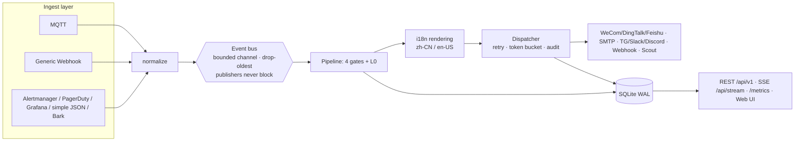

# Architecture

## One-sentence architecture

A single-process Go binary: **ingest layer (seven entry kinds) → event bus (bounded, drop-oldest) → alert pipeline (silence/dedup/cooldown/escalation + L0 algorithms) → dispatcher (retry/rate-limit/audit) → channel plugins**; SQLite as the cross-cutting store; REST + SSE + embedded Web UI as the egress.



## Three key invariants

1. **Publishers never block**: ingest callbacks only normalize and enqueue without blocking; a full bus drops the oldest and counts (`bell_events_dropped_total{stage=bus}`) — **the API never 5xxs because of downstream trouble**.
2. **Recoveries pass immediately**: a `resolved` event paired by `dedup_key` skips dedup/cooldown (silence still applies) and cancels the pending escalation timer.
3. **A pipeline failure ≠ a lost event**: any stage panic is recovered; the event degrades to "no-pipeline mode" straight to the default channel group, with an audit event.

## Backpressure model

| Queue | Default capacity | When full |
|---|---|---|
| eventbus (ingest→pipeline) | 1024 | drop-oldest + counter |
| dispatch queue (pipeline→channel) | 256 per channel | drop-oldest + counter |
| escalation timers | persisted table | never lost (the only persisted queue; timers survive restarts) |

SQLite: WAL mode, `busy_timeout=5s`, a single write connection (serialized writes), multiple readers. Comfortable from hundreds to tens of thousands of events per day.

## Migratable storage

Repositories depend only on `database/sql`; SQL stays ANSI (unix-millisecond integers, JSON in TEXT with app-side codecs, `RETURNING id`, `?` placeholders rebound per dialect) — SQLite dialect specifics live only inside the connector. The `storage.driver` slot reserves PostgreSQL; migrating = implementing a pg connector + the postgres migration dir, with zero repository or pipeline changes (`migrations/postgres/` is maintained in the same PRs as sqlite).

## The config / runtime-state boundary

```
config.yaml              → bootstrap: server / auth / storage / ingest connections
SQLite rules table       → routing rules (UI-editable)
SQLite channels table    → channel configs (encrypted credentials, UI-editable)
config.yaml rules/channels → first-boot seed only (imported once when DB is empty); DB wins afterwards
mibee-bell export        → reverse-export YAML (backup/migration)
```

This boundary means rule/channel changes never touch config files, and config.yaml stays safe for version control (bootstrap and credentials separated).

## Package layout

```
MiBeeBell/
├── cmd/mibee-bell/       # entry: flags, wiring, graceful shutdown
├── internal/
│   ├── config/           # YAML load/validate + hash-password / encrypt-config subcommands
│   ├── model/            # Event / Notification / Delivery / Rule / Channel / Silence
│   ├── eventbus/         # bounded bus (drop-oldest)
│   ├── mesh/             # memberlist + claim protocol + dead-man switch
│   ├── ingest/           # one package per source: mqtt / webhook / alertmanager / bark / …
│   ├── rule/             # rule matching (pure functions)
│   ├── pipeline/         # Processor chain + four gates and L0
│   ├── dispatch/         # retry/backoff, token buckets, delivery audit, channel health
│   ├── channel/          # channel plugins + registry (self-registering)
│   ├── ai/               # Analyzers (L1 decision / L2 openai_compat)
│   ├── store/            # database/sql repositories (sqlite; postgres reserved) + migrations
│   ├── render/           # i18n templates (zh-CN/en-US, severity mapping)
│   ├── api/              # REST + SSE + JWT middleware
│   └── ui/               # go:embed web/dist
├── pkg/bellapi/          # Channel / Processor / Analyzer interfaces — stable external contract
├── migrations/{sqlite,postgres}/
└── deploy/               # systemd / docker compose / install.sh / fnOS / Zabbix
```

Dependencies flow one way: `ingest → eventbus → pipeline → dispatch → channel`; `model` is depended on by everyone and depends on nothing. Third-party extensions import only `pkg/bellapi` (internal is closed to outsiders).

## Observability

- `/metrics` (Prometheus): `bell_events_ingested_total{source}`, `bell_notifications_total{channel,status}`, `bell_events_dropped_total{stage}`, `bell_channel_health{channel}`, `bell_escalation_pending`, `bell_pipeline_stage_duration_seconds`, `bell_ai_calls_total{analyzer,result}`, `bell_enrich_total`.
- Structured logs (slog, JSON optional): drops, escalations, silence hits and channel degradation all carry event_id.
- A Grafana dashboard JSON ships in-repo (`deploy/grafana-bell.json`).

## Deployment shape

Single binary (linux/arm64 · armv7 · amd64, windows/amd64) plus `deploy/` goodies: systemd unit, docker compose (CN and overseas topology examples), install.sh, an fnOS app package and a Zabbix media script. Default port `:9080`.
