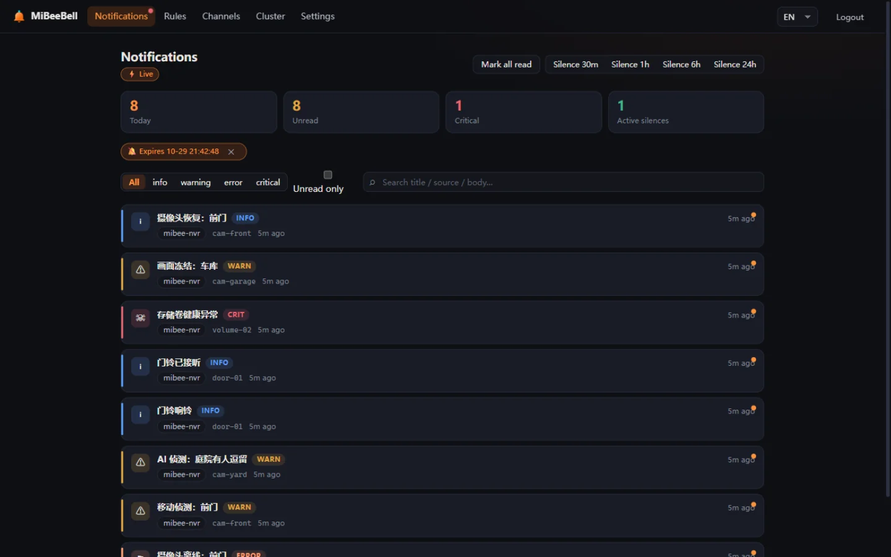

# Introduction

**MiBeeBell** is the unified alert notification hub of the MiBee ecosystem: **events in (seven ingest entry points) → dedup / cooldown / escalation / silence (alert pipeline) → notifications out (CN & international channels + MiBeeScout loop)**.

In one sentence: wire everything that "alerts" in your home or office (NVR, monitoring, scripts, IoT, Prometheus…) into one small single-binary service that denoises, aggregates and delivers to WeCom / DingTalk / Feishu / Telegram / email and more — **no notification storms, quiet recoveries, and the alert hub itself never becomes a silent single point of failure**.



## Why it exists

Pushing alerts from every system straight into a group bot "works" — until you hit four problems: **repeat bombardment** (a camera flapping 30 times a minute = 30 messages), **no recovery notices** (nobody tells you when it healed), **manual do-not-disturb** (night alerts: either endure or miss), and **the hub itself is a single point** (when it dies, the whole world goes quiet). MiBeeBell's configurable pipeline solves the first three; its mesh cluster solves the fourth.

A full ecosystem survey (2026-10) concluded that **no open-source project occupies all of these positions at once**:

| Capability | ntfy | Gotify | Nightingale | Alertmanager | MiBeeBell |
|---|---|---|---|---|---|
| Single binary + SQLite, runs on a Pi | ✅ | ✅ | ❌ needs MySQL+Redis | ✅ | ✅ |
| Alert pipeline (dedup/aggregation/cooldown/silence/escalation) | ❌ | ❌ | ✅ | ✅ | ✅ |
| CN channels (WeCom/DingTalk/Feishu) | ❌ | ❌ | ✅ | ❌ | ✅ |
| MQTT ingest as a first-class citizen | ❌ | ❌ | ❌ | ❌ | ✅ |
| Drop-in compat (Alertmanager / Bark / PagerDuty / ntfy payloads) | ❌ | ❌ | ❌ | — | ✅ |

The niche is also in turmoil: Opsgenie EOLs in 2027-04, self-hosted Grafana OnCall is archived, PushDeer is unmaintained — "a living lightweight self-hosted alerting hub" has itself become a scarce label.

## Design iron laws

Distilled from post-mortems of dead competitors — five non-negotiables:

1. **Truly self-hosted = zero cloud dependency**: no feature depends on the vendor's cloud; channel credentials live on the user's disk (AES-256-GCM encrypted). Offline, domain-dead, or company-gone — every feature keeps working.
2. **One codebase, the open source IS the product**: AGPL-3.0 in full, no community/enterprise dual track.
3. **Replaceable channel layer**: one channel = one file = one interface. Any platform policy change kills that adapter, not the project.
4. **AI augments, never gates**: the L0 pure-algorithm layer is always on; AI (L1 triage / L2 summaries) is pluggable, off by default, can only downgrade severity and can never drop an event — with AI dead, notifications still flow.
5. **Minimum maintenance surface**: no monitoring, no probing, no on-call scheduling, no first-party app client (MiBeeScout owns that niche).

## Technical shape

- **Go 1.26, `CGO_ENABLED=0` single binary**: linux/arm64 · armv7 · amd64 and windows/amd64; < 80MB RSS on a Raspberry Pi 3B design line (measured single-instance RSS ≈ 15–21MB).
- **modernc.org/sqlite** (pure-Go SQLite, WAL), storage layer designed to be PostgreSQL-migratable.
- **Svelte 5 embedded Web UI** (`go:embed`, dark-first, zh/en) — the full admin UI ships inside the binary.
- **memberlist** (SWIM gossip) mesh HA: 2–5 all-active nodes; any node dying never interrupts notifications.
- Default port `:9080` (distinct from MiBeeNvr `:9090` and MiBeeSteward `:8080`).

## Ecosystem position

```
MiBeeNvr (NVR) ─┐
MiBeeSteward (asset discovery) ─┤                 ┌─ WeCom / DingTalk / Feishu
Prometheus / Alertmanager ─┼─▶ MiBeeBell ─────────┼─ Telegram / Slack / Discord / SMTP
any script / cron / IoT ─┘     (pipeline+denoise) ├─ generic Webhook
                                 └─ MiBeeScout (ecosystem app notification center)
```

## Roadmap (internal milestones, not releases)

| Milestone | Scope | Status |
|---|---|---|
| **v0.1** | 4 ingest entries (webhook/Alertmanager/Bark/MQTT) + 8 channels + four gates + full L0 + SQLite + SSE + embedded UI | ✅ shipped |
| **v0.2** | mesh HA (claim lease / dead-man switch / silence sync), at-rest credential encryption, Scout notification-center API, http_enrich external tagging | ✅ shipped (accepted on a real two-node setup) |
| **v0.3** | paid critical channels (Twilio/PagerDuty/Opsgenie), WeCom app messages, LINE, Scout international push; PagerDuty/simple-JSON/Grafana ingest landed early | 🚧 partially early |
| **v1.0** | per-person routing, federation, bilingual docs, full GitHub Release + Docker + install.sh distribution | planned |

> MiBeeBell has **not published any release yet** (no tags / no release artifacts; releasing is decided by the maintainer) — this manual tracks the in-development main branch; the first official version will ship via GitHub Releases.

## License

AGPL-3.0 (same as MiBeeNvr / MiBeeSteward).
