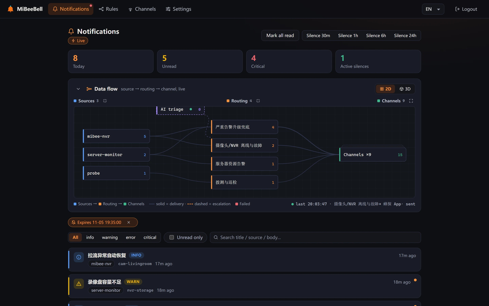

# Introduction

**MiBeeBell** is the unified alert notification hub of the MiBee ecosystem: **events in (seven ingest entry points) → dedup / cooldown / escalation / silence (alert pipeline) → notifications out (CN & international channels + MiBeeScout loop)**.

In one sentence: wire everything that "alerts" in your home or office (NVR, monitoring, scripts, IoT, Prometheus…) into one small single-binary service that denoises, aggregates and delivers to WeCom / DingTalk / Feishu / Telegram / email and more — **no notification storms, quiet recoveries, and the alert hub itself never becomes a silent single point of failure**.

## Why it exists

Pushing alerts from every system straight into a group bot "works" — until you hit four problems: **repeat bombardment** (a camera flapping 30 times a minute = 30 messages), **no recovery notices** (nobody tells you when it healed), **manual do-not-disturb** (night alerts: either endure or miss), and **the hub itself is a single point** (when it dies, the whole world goes quiet). MiBeeBell's configurable pipeline solves the first three; its mesh cluster solves the fourth.

A full ecosystem survey (2026-10) concluded that **no open-source project occupies all of these positions at once**:

| Capability | ntfy | Gotify | Nightingale | Alertmanager | MiBeeBell |
|---|---|---|---|---|---|
| Single binary + SQLite, runs on a Pi | ✅ | ✅ | ❌ needs MySQL+Redis | ✅ | ✅ |
| Alert pipeline (dedup/aggregation/cooldown/silence/escalation) | ❌ | ❌ | ✅ | ✅ | ✅ |
| CN channels (WeCom/DingTalk/Feishu) | ❌ | ❌ | ✅ | ❌ | ✅ |
| MQTT ingest as a first-class citizen | ❌ | ❌ | ❌ | ❌ | ✅ |
| Drop-in compat (Alertmanager / Bark / PagerDuty / ntfy payloads) | ❌ | ❌ | ❌ | — | ✅ |

The niche is also in turmoil: Opsgenie EOLs in 2027-04, self-hosted Grafana OnCall is archived, PushDeer is unmaintained — "a living lightweight self-hosted alerting hub" has itself become a scarce label.

## Design iron laws

Distilled from post-mortems of dead competitors — five non-negotiables:

1. **Truly self-hosted = zero cloud dependency**: no feature depends on the vendor's cloud; channel credentials live on the user's disk (AES-256-GCM encrypted). Offline, domain-dead, or company-gone — every feature keeps working.
2. **One codebase, no dual track**: a single product edition — no community/enterprise split.
3. **Replaceable channel layer**: one channel = one file = one interface. Any platform policy change kills that adapter, not the project.
4. **AI augments, gated only behind an off-by-default switch**: the L0 pure-algorithm layer is always on; AI (L1 triage / L2 summaries) is pluggable, off by default, can only downgrade severity — with AI dead, notifications still flow. The one capability that lets AI "drop" alerts — the controlled pipeline-intervention framework (ADR-036) — is fully disabled by default and requires validation in shadow (observe-only) mode before it can be enabled.
5. **Minimum maintenance surface**: no monitoring, no probing, no on-call scheduling, no first-party app client (MiBeeScout owns that niche).

## Technical shape

- **Go 1.26, `CGO_ENABLED=0` single binary**: linux/arm64 · armv7 · amd64 and windows/amd64; < 80MB RSS on a Raspberry Pi 3B design line (measured single-instance RSS ≈ 15–21MB).
- **modernc.org/sqlite** (pure-Go SQLite, WAL), storage layer designed to be PostgreSQL-migratable.
- **Svelte 5 embedded Web UI** (`go:embed`, dark-first, zh/en) — the full admin UI ships inside the binary.
- **memberlist** (SWIM gossip) mesh HA: 2–5 all-active nodes; any node dying never interrupts notifications.
- Default port `:9080` (distinct from MiBeeNvr `:9090` and MiBeeSteward `:8080`).

## Ecosystem position

## Roadmap (internal milestones, not releases)

| Milestone | Scope | Status |
|---|---|---|
| **v0.1** | ingest entries (webhook/Alertmanager/Bark/MQTT) + gate pipeline + full L0 + SQLite + SSE + embedded UI | ✅ released |
| **v0.2** | mesh HA (claim lease / dead-man switch / silence sync), at-rest credential encryption, Scout notification-center API, http_enrich external tagging | ✅ released |
| **v0.3** | full 17-channel set (Twilio/PagerDuty/Opsgenie/WeCom app/LINE…), PagerDuty/simple-JSON/Grafana ingest, AI triage (L1 embedded model + L2 cloud) with the controlled pipeline-intervention framework, first-run setup wizard | ✅ released (delivered with the v0.1.x series) |
| **v1.0** | per-person routing, federation | planned |

> The first official release, **v0.1.0, shipped on 2026-11-04** (GitHub Releases provide Linux/Windows single binaries and the fnOS fpk package) — see the Releases page for later versions. This manual tracks the latest released version.

## License

[AGPL-3.0](https://github.com/Mi-Bee-Studio/MiBeeBell/blob/main/LICENSE) — same as MiBeeNvr / MiBeeSteward.
