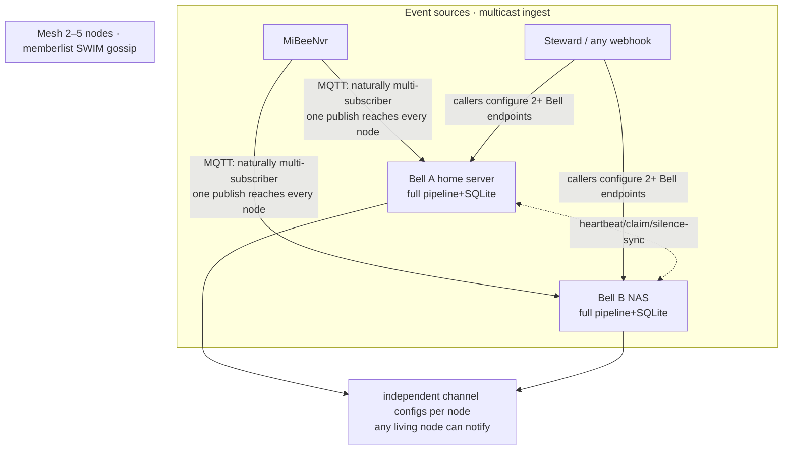

# High Availability (Mesh)

**The alert hub itself must not die** — the worst failure mode of an alerting system is a silent death: it goes quiet, and nobody hears about anything anywhere. MiBeeBell v0.2 ships an all-active masterless mesh, accepted on a real two-node setup (mutual exclusion ✓ / kill-the-leader takeover ✓ / node_down delivered after the 30s grace ✓ / single-node RSS ≈ 15–21MB).

## Design stance

1. **Single-node mode remains a first-class citizen**: an empty `mesh:` config = standalone, zero extra dependencies (Pi users pay nothing).
2. The goal is "**any single node dying never interrupts notifications**" — not "zero duplicates".
3. **Duplicates beat silence**: during a partition or takeover we'd rather double-send than miss — the correct trade-off in the alerting domain.
4. No etcd/raft-style heavy machinery: SQLite per node + gossip, consistent with the ecosystem's genes (CGO-free, Pi-friendly).

## Topology: all-active, masterless



2–5 nodes (home server / NAS / VPS / Pi), **each fully autonomous**: complete pipeline + its own SQLite + its own channel configs — there is no "leader". Ingest is naturally multicast: MQTT is pub/sub, one publish reaches all nodes; webhook-style sources just configure 2+ Bell endpoints.

## The claim protocol (cross-node notification uniqueness)

Every node receives every event and runs the pipeline; **the right to notify is won by claim**:

1. Before sending, a node broadcasts `claim{dedup_key, node, lease=90s}`;
2. Peers holding a valid lease store but don't deliver (deliveries record `skipped:mesh_claim`);
3. If the lease expires without a `sent` confirmation, the other nodes take over delivery (**self-healing when a node dies mid-notification**);
4. claim/sent are in-memory: a node restart re-sends at most one notification (same philosophy as the dedup window; not persisted).

## Dead man's switch

- Heartbeats via memberlist SWIM (1s probe / 5s suspicion / secondary confirmation).
- A confirmed-dead peer makes survivors emit **`bell.node_down` (critical)** through their own channels; recovery emits `bell.node_up` (info) — watchdogs biting each other.
- False-positive suppression: node_down waits 30s and requires a second corroborating peer — both sides of a network partition stay alive without accusing each other.
- **Total-outage backstop**: if the whole mesh dies, an external probe (e.g. a MiBeeHive scheduled dead-man switch) alerts through an independent channel.

## Data-consistency tiers

| Data | Strategy within the mesh |
|---|---|
| **silences** | **must sync** — an unsynced silence is a broken one: node A is silenced, node B keeps firing (upsert/delete by content key + join snapshot) |
| rules / channels | per-node independent + **drift detection** (UI warning + built-in node alert on divergence) |
| events / deliveries | kept locally (history sharding is tolerable; the `events.node` column marks the handling node) |

## Failure matrix

| Failure | Behavior |
|---|---|
| One node dies | events keep flowing (multicast ingest); the expired claim lease lets peers take over unfinished notifications; node_down alert fires |
| Network partition | both sides deliver (**duplicates beat silence**); the two-peer corroboration suppresses false node_downs |
| All nodes die | external watchdog backstop |
| One node's SQLite corrupts | node autonomy: others unaffected; the broken node restores from backup |
| Misconfigured mesh (island) | a node_down hint within 30s — a silent multi-node island is more visible than a silent single node |

## Configuration

```yaml
mesh:
  node_name: "bell-a"          # defaults to hostname
  bind_port: 7946              # gossip UDP/TCP port
  join:                        # seed nodes (several allowed)
    - "192.0.2.11:7946"
    - "192.0.2.12:7946"
```

`GET /api/v1/mesh` is the observability endpoint: member list, per-node status, claim and silence-sync state (the UI "Cluster" page reads the same).

> Engineering notes: memberlist callbacks run on a goroutine holding internal locks — calling member APIs synchronously from a callback deadlocks, so everything is dispatched asynchronously; gossip echoes your own membership back, so heartbeats filter self-echoes.
