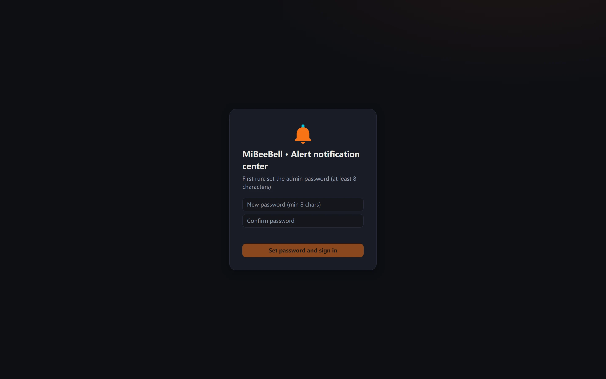
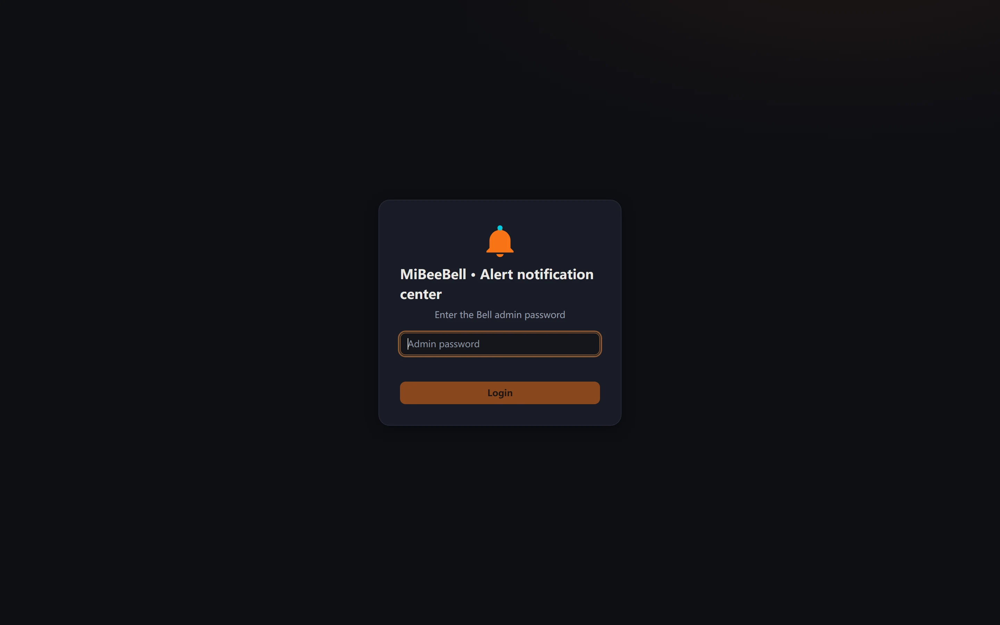

# Quick Start

Goal: get MiBeeBell running on a Linux box, fire your first alert and receive the notification — **in about 5 minutes**.

> Commands are copy-paste ready. Example addresses use the documentation range `192.0.2.10` — replace with your instance address.

## 1. Install (two ways)

**fnOS app** (recommended): download the matching `mibee-bell-fnos-<version>-arm64.fpk` (or `-x86.fpk`) → App Center manual install → open "Bell" from the desktop.

**Binary**: grab the matching build from the [Releases hub](https://github.com/mickeyzzc/releases/releases/tag/mibeebell-v0.1.0) (with checksums.txt), drop it anywhere:

```bash
./mibee-bell -listen :9080
```

Zero config works: without a config.yaml it listens on `:9080` and stores SQLite in `./bell.db`; everything else is configured in the Web UI (written back to yaml automatically).

## 2. First open: set the admin password

Open `http://192.0.2.10:9080` in a browser — a brand-new instance lands on the **first-run password page**; enter a password (≥8 chars), confirm, and you're signed in:



> CLI alternative: `./mibee-bell hash-password` prints a bcrypt hash for config.yaml's `auth.password_hash` — useful when initializing headless (write the full config before first boot). With an empty hash, the Web home always offers the first-run setup form and the admin API answers 403 `setup_required` until a password exists.

After setup, log in (password on direct access; SSO from the fnOS desktop):



## 3. Add a channel

"Channels" → New. The quickest channel to verify with is a **generic Webhook** (any URL that accepts POST); for real use, your group bot:

| Channel | Key credential |
|---|---|
| WeCom robot | the `key` from the group-bot webhook URL |
| DingTalk robot | `access_token` + signing `secret` |
| Feishu robot | webhook URL (optional signature) |
| Telegram | bot `token` + `chat_id` (per-channel proxy supported) |
| Bark / ntfy | server + device key / topic |
| SMTP | host / account / password |
| Generic Webhook | target URL (optional HMAC-SHA256 signing) |

Hit "Send test" to verify. Credentials are AES-256-GCM encrypted at rest; the UI and API only ever show `***`.

## 4. Create a rule

"Rules" → New rule: **match** on the source bound to your ingest token (step 5's `myapp`) with minimum severity `error`, **target channels** = the channel from step 3, **cooldown** 300s (no re-bombardment of the same subject within 5 minutes); add an escalation chain if you want one. Effective on save — no restart.

## 5. Fire your first alert

First create an ingest token (**Settings → Ingest & tokens → New token** — the value is shown only once), or pre-seed it in config.yaml:

```yaml
ingest:
  webhook_tokens:
    - token: "my-ingest-token-1"      # any long random string; stored on both sides
      default_source: "myapp"
  alertmanager: true                  # also enable the Prometheus/Grafana entry
```

Then:

```bash
curl -X POST "http://192.0.2.10:9080/api/ingest/webhook/my-ingest-token-1" \
  -H "Content-Type: application/json" \
  -d '{"type":"demo_alert","severity":"error","title":"first test alert",
       "body":"hello from curl","source_ref":"demo-1"}'
# 202 {"event_id":"..."} — accepted into the pipeline; check the UI for the notification & deliveries
```

Send a **recovery event** with the same `dedup_key` and watch the paired "resolved" notice arrive:

```bash
curl -X POST "http://192.0.2.10:9080/api/ingest/webhook/my-ingest-token-1" \
  -H "Content-Type: application/json" \
  -d '{"type":"demo_alert","severity":"info","title":"first test alert resolved",
       "source_ref":"demo-1","resolved":true}'
```

## 6. Wire up existing systems (zero refactor)

```yaml
# Prometheus Alertmanager — alertmanager.yml
route:
  receivers: [bell]
receivers:
  - name: bell
    webhook_configs:
      - url: http://192.0.2.10:9080/api/ingest/alertmanager
```

Existing Bark-ecosystem scripts just swap `api.day.app/yourkey` for `http://192.0.2.10:9080/yourkey`. More entries in [Event Ingest](ingest.md).

## Requirements & next steps

- Any Linux (arm64 / armv7 / amd64) or Windows x64; 512MB RAM is plenty.
- Next: [Web UI Tour](web-ui.md) · [Alert Pipeline](pipeline.md) · [High Availability](mesh.md) · [FAQ & Troubleshooting](faq.md)
