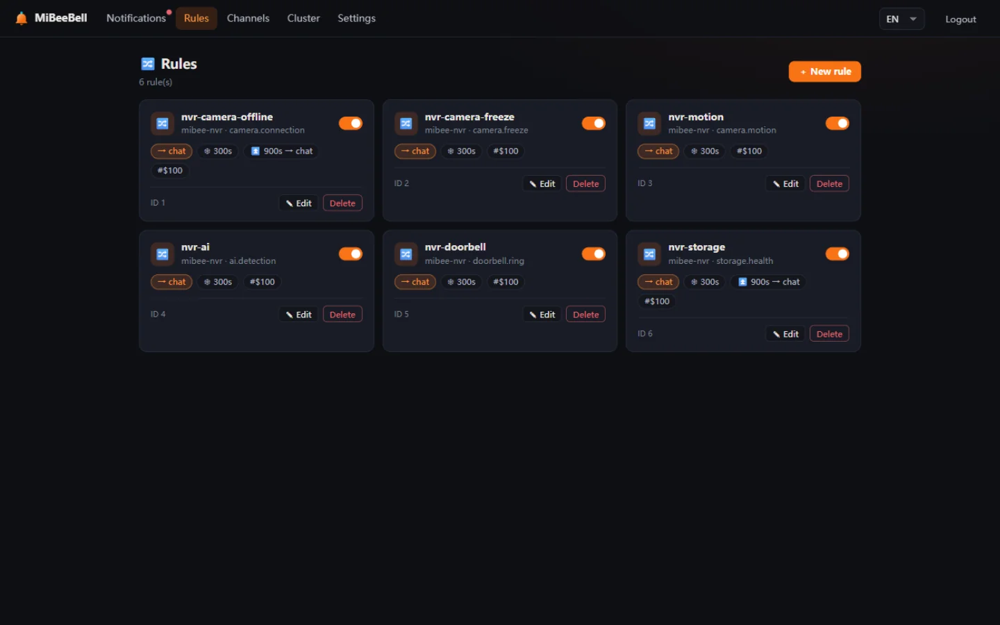
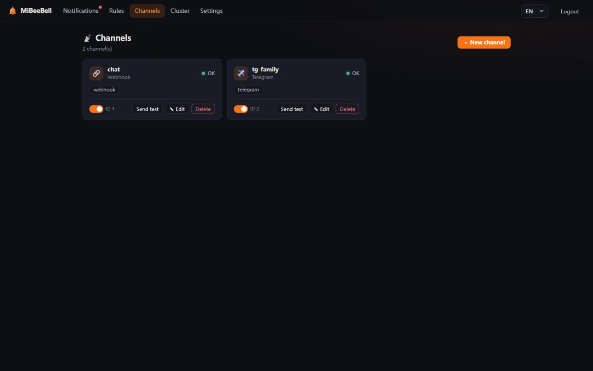
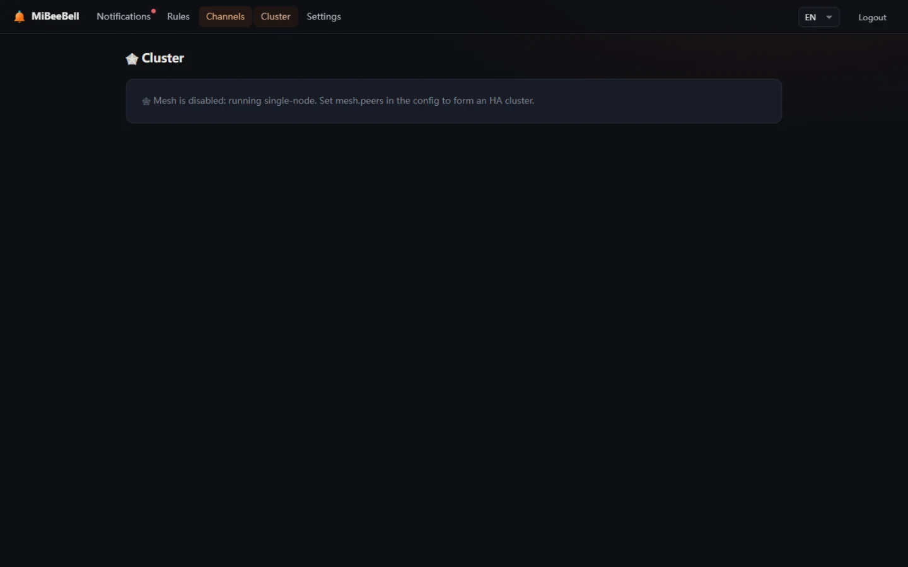
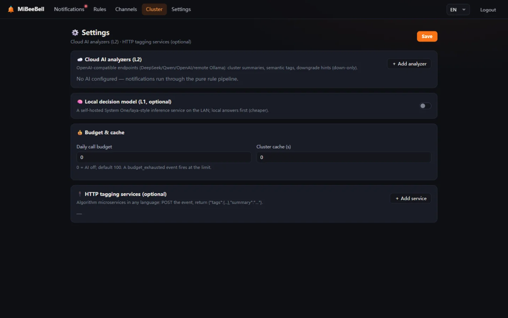

# Web UI Tour

MiBeeBell's admin UI is built with Svelte 5 and embedded into the binary via `go:embed` — **no frontend build step, no extra port, it's just there**. Dark-first design, zh/en toggle in the top bar. All screenshots below are from a real demo instance (demo data).

## Notification Center (history + silences)

The landing page after login. Four stat cards on top (today / unread / critical / active silences); below, the notification stream: every notification carries a severity badge (INFO / WARN / ERROR / CRIT, color-coded), its source, its subject (`source_ref`) and a relative time. The `⚡ live` badge means the SSE stream is connected.

Everything you reach for daily lives on this page:

- **Filters**: by severity, unread-only, and free-text search over title/source/body.
- **One-tap silence**: the top buttons ("Silence 30m / 1h / 6h / 24h") instantly create a silence for the selected notification's `dedup_key` — the button you want at 3am.
- **Recovery pairing**: incident and recovery notifications pair up via `dedup_key`; recoveries bypass all gates and are delivered immediately.

## Routing Rules

A rule = "which events (match) → which channels → how to treat them (dedup/cooldown/escalation)". Each rule is a card: match expression, target channels, dedup window, cooldown window, escalation chain (`escalate_after` + `escalate_to`), whether recoveries notify, and the L0 persist-filter count.

Rules live in SQLite and take effect on save — no restart. Lower `priority` wins; ties break by rule id.

## Channels

One channel = one config: type (WeCom/DingTalk/Feishu/SMTP/Telegram/Slack/Discord/generic Webhook…), credentials, per-channel egress proxy, enable/disable. Health (ok / degraded / disabled) is visible at a glance — repeated delivery failures auto-flag the channel as degraded.

The "Send test" button renders a real notification through the channel to verify credentials and connectivity. Credential fields are encrypted on write (AES-256-GCM) and masked on read — the UI and API only ever show `***`.

## Cluster (Mesh)

The observability page for the 2–5 node all-active mesh: member list, per-node status, claim leases and silence-sync state. In single-node mode you'll just see yourself. When a node dies, survivors emit a `bell.node_down` alert within 30 seconds — watchdogs biting each other.

## Settings

The config home for the two enhancement axes:

- **AI Providers (L2 summaries)**: OpenAI-compatible endpoints (DeepSeek / Qwen / OpenAI / remote Ollama) — configure and go. See [AI Enhancements](ai.md).
- **Enrich services (external tagging)**: the `http_enrich` processor — POST the event to any HTTP service, return `tags` / `summary`, done. "Algorithm microservices" in any language plug into the pipeline.

## Mobile

Responsive layout — the silence and mark-read actions work fine on a phone browser. The native app experience is provided by **MiBeeScout**, the ecosystem app: it consumes Bell's notification-center API (unread list + read sync + live SSE push), and tapping a notification deep-links into NVR playback.
