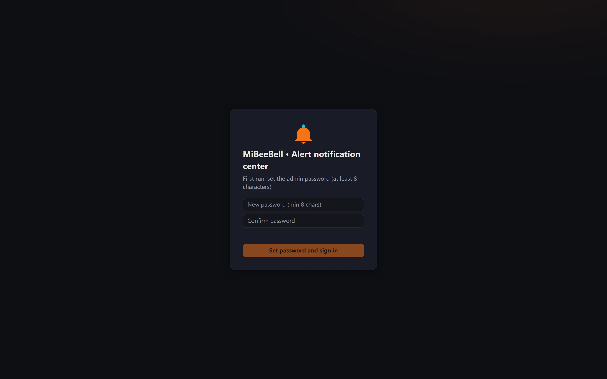
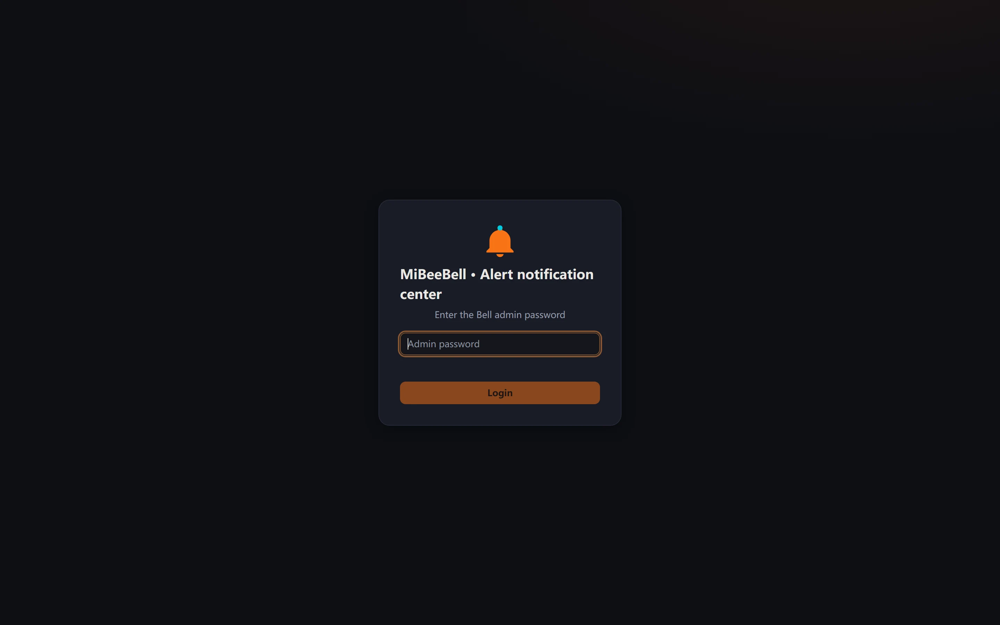
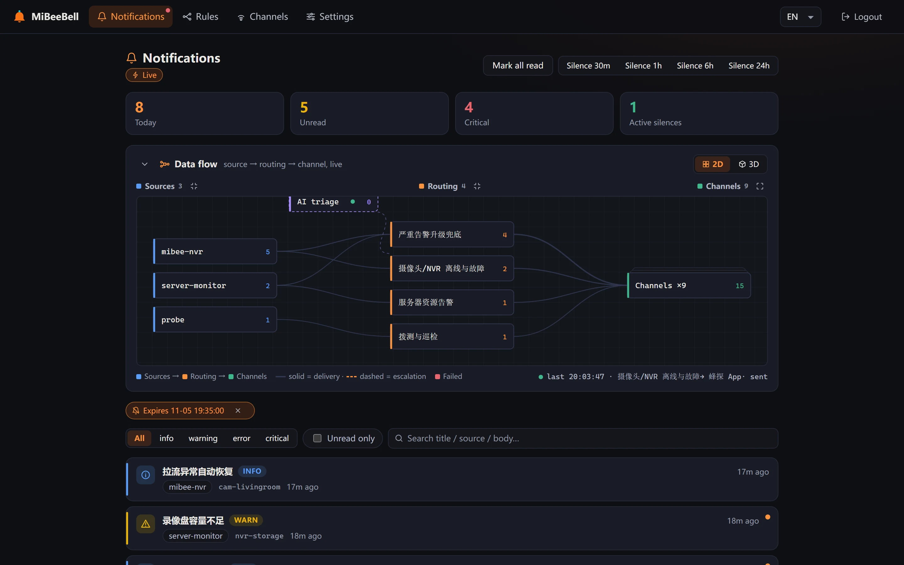
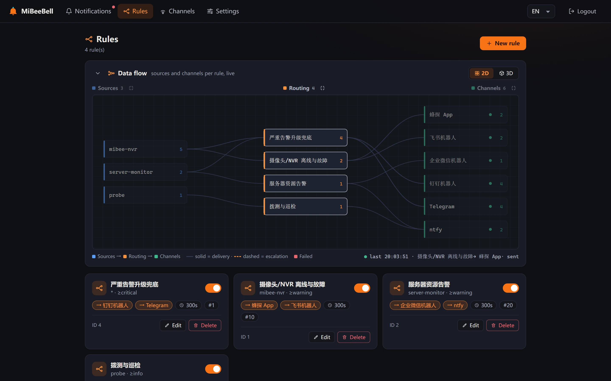
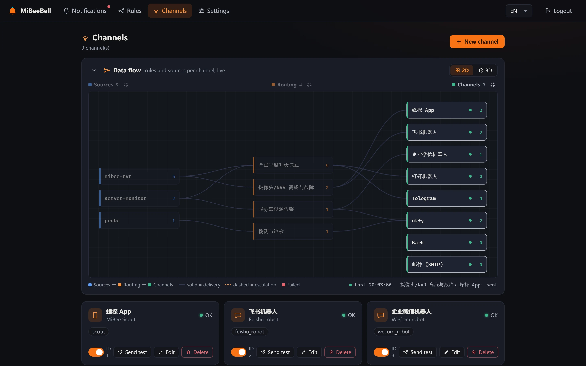
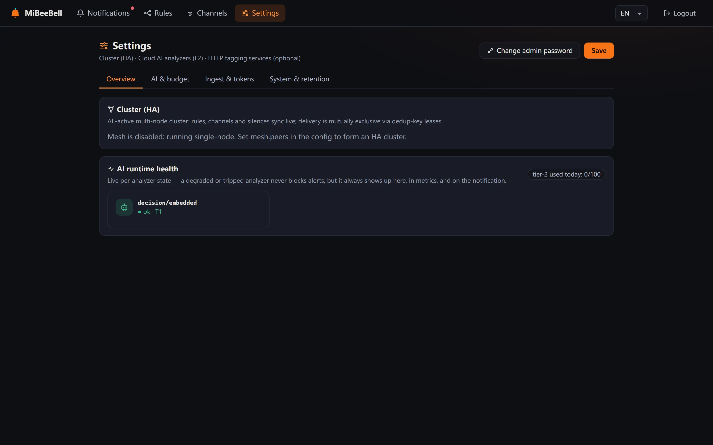

# Web UI Tour

MiBeeBell's admin UI is embedded into the binary — **no frontend build step, no extra port, it's just there**. Dark-first design, zh/en toggle in the top bar. All screenshots below are from a real demo instance (demo data).

Four pages after login: **Notifications** (default), **Rules**, **Channels**, **Settings**.

## First open: set the admin password

A brand-new instance opens on the first-run password page (≥8 characters); setting it signs you in. Direct port access afterwards uses the regular login page. In fnOS app form, entering from the NAS desktop is single-sign-on — no second login.

## Notifications

The inbox for everything. Four stat cards on top (today / unread / critical / active silences); below them the **data-flow graph** (see next section); then the notification stream: every notification carries a severity badge (INFO / WARN / ERROR / CRIT, color-coded), its source, its subject (`source_ref`) and a relative time. The `⚡ live` badge means the SSE stream is connected.

Everything you reach for daily lives on this page:

- **Filters**: by severity, unread-only, and free-text search over title/source/body.
- **One-tap silence**: the top buttons ("Silence 30m / 1h / 6h / 24h") instantly create a silence for the selected notification's `dedup_key` — the button you want at 3am.
- **Recovery pairing**: incident and recovery notifications pair up via `dedup_key`; recoveries bypass all gates and are delivered immediately.

**Open any notification** for the full detail: body, source and event ID, **per-channel delivery details** (delivered ×N / failure reasons), plus three feedback buttons — "Useful", "False positive", "Create rule from this" (false-positive silences that key; create-rule jumps to the rules page with the match pre-filled).

## Data-flow graph (2D / 3D)

The "Data flow" panel at the top of each page is a live visualization of the pipeline: **sources → routing → channels**, solid lines = deliveries, dashed = escalations, red = failures; the number beside a node is its 24h traffic. The 2D/3D toggle sits at the top right (3D supports drag-rotate and wheel-zoom). With AI triage enabled, its health and usage show up live in the graph too.

Each page has its own angle:

- **Notifications**: the global flow overview;
- **Rules**: a marshalling-yard view, rules stacked top-down by priority — never-matched rules (dashed tracks) stand out at a glance;
- **Channels**: "health towers" — tower height = 24h traffic, tower body = success/failure ratio, tower top color = health.

## Routing Rules

A rule = "which events (match) → which channels → how to treat them (dedup/cooldown/escalation)". Each rule is a card: match expression, target channels, dedup window, cooldown window, escalation chain (`escalate_after` + `escalate_to`), whether recoveries notify, and the L0 persist-filter count.

Rules live in SQLite and take effect on save — no restart. Lower `priority` wins; ties break by rule id.

## Channels

One channel = one config: type (WeCom/DingTalk/Feishu/Telegram/SMTP/Slack/Discord/Bark/ntfy/generic Webhook — 17 types in total), credentials, per-channel egress proxy, enable/disable. Health is visible at a glance — repeated delivery failures auto-flag the channel.

The "Send test" button renders a real notification through the channel to verify credentials and connectivity. Credential fields are encrypted on write (AES-256-GCM) and masked on read — the UI and API only ever show `***`.

## Settings

Four tabs:

- **Overview**: the cluster (HA) status card + the AI health card + change-password. The observability entry for the 2–5 node all-active mesh: member list, per-node status, claim leases and silence-sync state. In single-node mode it shows a single-mode hint; when a node dies, survivors emit a `bell.node_down` alert automatically.
- **AI & budget**: cloud AI analyzers (L2), the local decision model (L1), daily budget, breaker tuning; at the bottom, the off-by-default "AI pipeline intervention (high risk)" section (red risk hints + shadow mode) — see [AI Enhancements](ai.md).
- **Ingest & tokens**: the five compat-route toggles (Alertmanager / PagerDuty / simple JSON / Grafana / Bark), **ingest token** management (add/remove takes effect immediately, per-token rate limiting), and the OpenTelemetry export toggle.
- **System & retention**: render language and timezone, retention windows for events/notifications/deliveries.

## Mobile

Responsive layout — the silence and mark-read actions work fine on a phone browser. The native app experience is provided by **MiBeeScout**, the ecosystem app: it consumes Bell's notification-center API (unread list + read sync + live SSE push), and tapping a notification deep-links into NVR playback.
