# 架构

## 一句话架构

单进程 Go 二进制：**摄取层（七类入口）→ 事件总线（有界、满丢最旧）→ 告警管道（静默/去抖/冷却/升级 + L0 算法）→ 分发器（重试/限速/审计）→ 渠道插件（多渠道）**；SQLite 横切存储；REST + SSE + 嵌入式 Web UI 出口。



## 三条关键不变量

1. **发布者永不阻塞**：摄取回调只做规范化 + 非阻塞投递，总线满即丢最旧并计数（`bell_events_dropped_total{stage=bus}`）——**接口永不因下游故障 5xx**。
2. **恢复事件立即放行**：`resolved` 事件与故障侧同 `dedup_key` 配对成功后，跳过去抖/冷却（只走静默闸），并取消对应的升级计时。
3. **管道故障 ≠ 事件丢失**：任何管道环节 panic 由 recovery 兜底，事件按"无管道模式"直发默认渠道组并记审计事件。

## 背压模型

| 队列 | 默认容量 | 满时行为 |
|---|---|---|
| eventbus（摄取→管道） | 1024 | 丢最旧 + 计数 |
| dispatch queue（管道→渠道） | 每渠道 256 | 丢最旧 + 计数 |
| escalation 计时 | 持久化表 | 不丢（唯一持久化队列，进程重启后恢复计时） |

SQLite：WAL 模式、`busy_timeout=5s`、单写连接（写路径串行化）、读多连接。百条/天到万条/天量级富余。

## 存储可迁移

仓储只依赖 `database/sql`，SQL 全 ANSI（unix 毫秒整数时间戳、JSON 存 TEXT 应用侧编解码、`RETURNING id`、占位符统一 `?` 由 rebind 层转方言）——SQLite 方言特性只出现在连接器内。`storage.driver` 配置位已预留 PostgreSQL；迁移 = 实现 pg 连接器 + postgres 迁移目录，仓储与管道零改动（`migrations/postgres/` 与 sqlite 目录同 PR 维护）。

## 配置与运行态的边界

```
config.yaml             → 引导配置：server / auth / storage / ingest 连接
SQLite rules 表          → 路由规则（UI 可编辑）
SQLite channels 表       → 渠道配置（凭证加密落库，UI 可编辑）
config.yaml 的 rules/channels → 仅首次启动 seed（DB 为空时导入一次），此后 DB 为准
mibee-bell export        → 反向导出 YAML（备份/迁移）
```

这条边界让"改规则/换渠道"不需要碰配置文件，也让配置文件可以安全进版本管理（引导配置与凭证分离）。

## 数据流总览



## 可观测性

- `/metrics`（Prometheus）：`bell_events_ingested_total{source}`、`bell_notifications_total{channel,status}`、`bell_events_dropped_total{stage}`、`bell_channel_health{channel}`、`bell_escalation_pending`、`bell_pipeline_stage_duration_seconds`、`bell_ai_calls_total{analyzer,result}`、`bell_enrich_total`。
- 结构化日志（JSON 可选）：丢弃 / 升级 / 静默命中 / 渠道降级等关键决策全部带 event_id。

## 部署形态

单二进制零依赖（linux/amd64 · arm64 · armv6，windows/amd64）+ 飞牛 fnOS 原生应用。安装与 systemd 示例见[部署](deployment.md)。默认端口 `:9080`。
