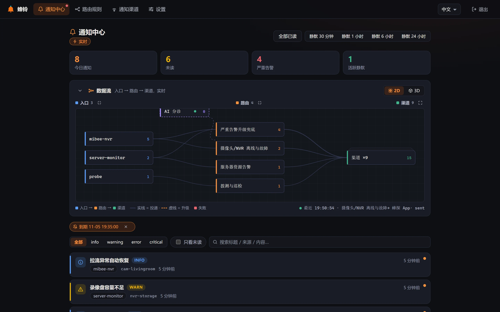

# 产品介绍

**MiBeeBell（蜂铃）** 是 MiBee 生态的统一告警通知中心：**事件进（七类摄取入口）→ 去抖 / 冷却 / 升级 / 静默（告警管道）→ 通知出（国内外多渠道 + MiBeeScout 闭环）**。

一句话：把家里 / 公司里所有会"报警"的东西（NVR、监控、脚本、IoT、Prometheus……）接到一个单二进制小服务上，由它统一去噪、聚合并送达企微 / 钉钉 / 飞书 / Telegram / 邮件等渠道——**通知不轰炸、恢复不打扰、告警中心自己不挂**。

## 为什么需要它

把任意系统的告警直接推到群机器人是"能用"的，但很快就遇到四个问题：**重复轰炸**（摄像头一分钟掉线 30 次就是 30 条消息）、**没有恢复通知**（东西好了没人告诉你）、**免打扰靠手掐**（夜间告警要么忍要么漏）、**告警中心单点**（它一挂全世界安静）。MiBeeBell 用一条可配置的告警管道解决前三件，用 mesh 集群解决第四件。

2026-10 的全网调研结论：开源世界里**没有任何一个项目同时占据以下位置**——

| 能力 | ntfy | Gotify | 夜莺 | Alertmanager | MiBeeBell |
|---|---|---|---|---|---|
| 单二进制 SQLite，树莓派可跑 | ✅ | ✅ | ❌ 需 MySQL+Redis | ✅ | ✅ |
| 告警管道（去抖/聚合/冷却/静默/升级） | ❌ | ❌ | ✅ | ✅ | ✅ |
| 国内渠道（企微/钉钉/飞书） | ❌ | ❌ | ✅ | ❌ | ✅ |
| MQTT 摄取一等公民 | ❌ | ❌ | ❌ | ❌ | ✅ |
| 兼容存量生态（Alertmanager / Bark / PagerDuty / ntfy 载荷） | ❌ | ❌ | ❌ | — | ✅ |

同时赛道正值动荡窗口：Opsgenie 2027-04 停服、Grafana OnCall 自托管版归档、PushDeer 停更——"还活着的轻量自托管告警中心"本身成了稀缺标签。

## 设计铁律

来自对竞品兴衰的复盘，五条不可妥协的原则：

1. **真自托管 = 零云依赖**：任何功能不依赖运营方云服务中转，渠道凭证全部落用户本地磁盘（AES-256-GCM 加密）。断网、官方域名失效、公司消失三种情况下，全部功能依然完整可用。
2. **单一代码库，无双轨**：只有一个产品版本，无社区版/企业版之分。
3. **渠道层可替换**：一个渠道一个文件一个接口；任何渠道平台政策变化，死的只是那个适配器，不是项目。
4. **AI 只做增强，默认不做闸门**：L0 纯算法层永远在线；AI（L1 分诊 / L2 摘要）可插拔可关闭，只降级不升级 severity——AI 挂了通知照发。唯一能让 AI「拦」告警的管道介入能力（ADR-036）默认完全关闭，且必须先在观察模式（shadow）下验证准确率才允许开启。
5. **最小维护面**：不做监控、不做拨测、不做 on-call 排班、不做自研 App 客户端（MiBeeScout 承担生态位）。

## 技术形态

- **Go 1.26 · `CGO_ENABLED=0` 单二进制**：linux/arm64 · armv7 · amd64 与 windows/amd64，树莓派 3B 常驻内存 < 80MB（实测单实例 RSS 约 15–21MB）。
- **modernc.org/sqlite**（纯 Go SQLite，WAL 模式），存储层按 PostgreSQL 可迁移设计。
- **Svelte 5 嵌入式 Web UI**（`go:embed`，暗色优先，中/英双语），单二进制自带完整管理界面。
- **memberlist**（SWIM gossip）mesh 高可用：2–5 节点全活无主，任一节点死亡通知不中断。
- 默认端口 `:9080`（与 MiBeeNvr `:9090`、MiBeeSteward `:8080` 错开）。

## 生态位置

## 路线图（内部里程碑，非发布版本）

| 里程碑 | 范围 | 状态 |
|---|---|---|
| **v0.1** | 摄取入口（webhook/Alertmanager/Bark/MQTT）+ 四道闸 + L0 全量 + SQLite + SSE + 嵌入式 UI | ✅ 已发布 |
| **v0.2** | mesh 高可用（claim 租约/死亡开关/静默同步）、渠道凭证落库加密、Scout 通知中心 API、http_enrich 外部打标 | ✅ 已发布 |
| **v0.3** | 全量 17 类渠道（Twilio/PagerDuty/Opsgenie/企微应用/LINE 等）、PagerDuty/简单 JSON/Grafana 摄取入口、AI 分诊（L1 内嵌模型 + L2 云端）与受控介入框架、首装设密向导 | ✅ 已发布（随 v0.1.x 系列交付） |
| **v1.0** | 按人路由、多 Bell 联邦 | 计划 |

> 首个正式版本 **v0.1.0 已于 2026-11-04 发布**（GitHub Releases 提供 Linux/Windows 单二进制与飞牛 fpk 安装包），后续版本见 Releases 页——本文档跟随最新发布版本更新。

## License

待公布——暂不开源，许可证确定后在此更新。
