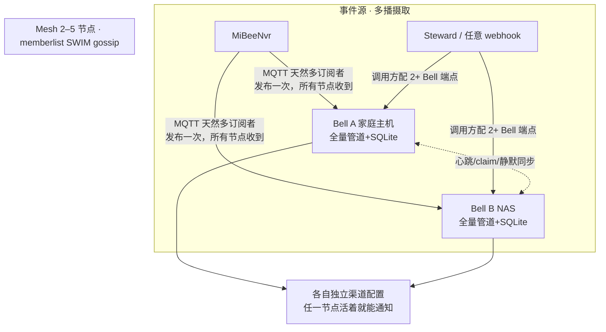

# 高可用集群（Mesh）

**告警中心自己不能挂**——告警系统最恶劣的故障形态是"无声死亡"：它一静默，全世界的故障都没人吭声。MiBeeBell v0.2 落地了全活无主 mesh 高可用，并通过了双实例真机验收（互斥 ✓ / 杀主接管 ✓ / 30s 宽限后 node_down 通知送达 ✓ / 单实例 RSS 约 15–21MB）。

## 设计立场

1. **单机模式依旧是一等公民**：`mesh:` 配置段为空 = 单节点，零额外依赖（树莓派用户不受累）。
2. 目标是"**任一节点死亡，通知不中断**"，不是"零重复"。
3. **重复通知优于静默**：分区/接管窗口宁可双发，绝不漏发——告警域的正确取舍。
4. 不引入 etcd/raft 类重基建：SQLite 单机 + gossip 组网，符合生态基因（CGO-free、树莓派可跑）。

## 拓扑：全活无主（active-active）



2–5 节点（家庭主机 / NAS / VPS / 树莓派），**每节点完全自治**：全量管道 + 独立 SQLite + 独立渠道配置——没有"主节点"概念。摄取天然多播：MQTT 是 pub/sub，发布一次全体收到；webhook 类来源把调用方配置成 2+ 个 Bell 端点即可。

## Claim 协议（跨节点通知唯一性）

所有节点都收到事件、都跑管道，**通知权靠 claim 竞争**：

1. 节点决定发通知前，向 mesh 广播 `claim{dedup_key, node, lease=90s}`；
2. 其他节点收到有效租约 → 只入库不投递（deliveries 记 `skipped:mesh_claim`）；
3. 租约到期且未收到 `sent` 确认 → 其余节点接管投递（**节点死亡时的通知自愈**）；
4. claim/sent 为内存态：节点重启最多重发一条（与 dedup 窗口同哲学，不落库）。

## 死亡开关（dead man's switch）

- 节点间心跳：memberlist SWIM（1s probe / 5s suspicion / 二次确认）。
- peer 确认死亡 → 幸存者发 **`bell.node_down`（critical）** 走自己的渠道；恢复发 `bell.node_up`（info）——"看门狗互相咬"。
- 误报抑制：node_down 延迟 30s 且需第二 peer 佐证——网络分区两侧各活着时互不冤告。
- **全灭兜底**：mesh 自己也全挂时，由外部独立探测兜底（任意一台 mesh 之外的普通主机，用 cron 定时 curl 各节点的 `/healthz`，失联即经独立渠道告警）。

## 数据一致性分级

| 数据 | mesh 内策略 |
|---|---|
| **silences（静默）** | **强制同步**——不同步 = 静默失效：A 节点静默、B 节点照发（upsert/delete 按内容键 + join 快照） |
| rules / channels | 各节点独立 + **drift 检测**（不一致时 UI 警示 + node 内建告警） |
| events / deliveries | 各自留存（历史分片可容忍，`events.node` 列标记处理节点） |

## 故障矩阵

| 故障 | 行为 |
|---|---|
| 单节点死亡 | 事件照收（多播摄取）；claim 租约到期其余节点接管未完成通知；node_down 告警 |
| 网络分区 | 两侧各自投递（**重复优于静默**）+ 双 peer 佐证抑制 node_down 误报 |
| 全部死亡 | 外部 watchdog 兜底告警 |
| 单节点 SQLite 损坏 | 节点自治：其余节点不受影响；损坏节点从备份恢复 |
| mesh 配置错误（孤岛） | 30s 内 node_down 提示——多节点静默孤岛比单机更醒目 |

## 配置

```yaml
mesh:
  node_name: "bell-a"          # 缺省 hostname
  bind_port: 7946              # gossip UDP/TCP 端口
  join:                        # 种子节点（可多个）
    - "192.0.2.11:7946"
    - "192.0.2.12:7946"
```

`GET /api/v1/mesh` 观测端点：成员列表、各节点状态、claim 与静默同步情况（UI「集群」页同源）。

> 工程细节：memberlist 回调在持内部锁的 goroutine 上执行，回调内同步调用成员 API 会死锁——实现中全部异步派发；gossip 会回流自身成员信息，心跳需做 self 回声过滤。
