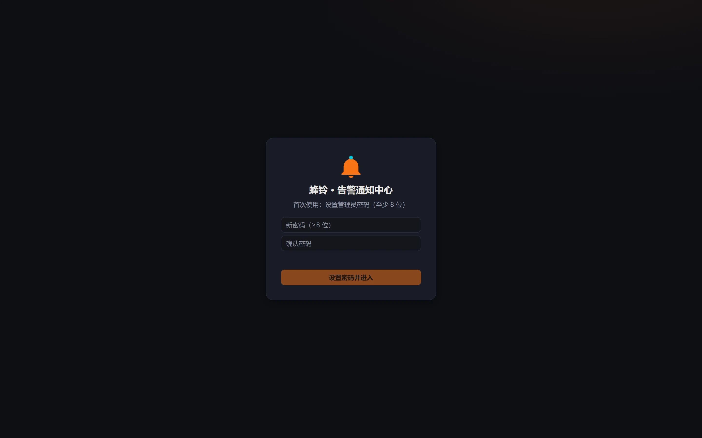
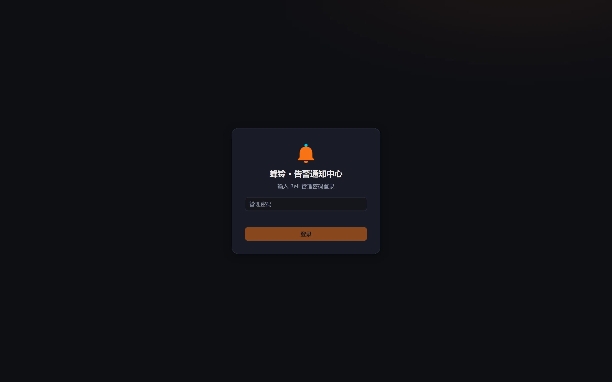

# 快速开始

目标：**5 分钟内**在一台 Linux 机器上跑起 MiBeeBell，发出第一条告警并收到通知。

> 命令逐字可执行。示例地址使用文档保留段 `192.0.2.10`，替换为你的实例地址。

## 1. 安装（两种方式）

**飞牛（fnOS）应用**（推荐）：下载对应架构的 `mibee-bell-fnos-<版本>-arm64.fpk`（或 `-x86.fpk`）→ 应用中心手动安装 → 桌面「蜂铃」图标进入。

**二进制**：从[发布会 Releases](https://github.com/mickeyzzc/releases/releases/tag/mibeebell-v0.1.0) 下载对应平台可执行文件（附 checksums.txt 校验），放到任意目录：

```bash
./mibee-bell -listen :9080
```

零配置即可启动：无 config.yaml 时监听 `:9080`、SQLite 落同目录 `bell.db`，其余配置全部在 Web 界面完成（自动写回 yaml）。

## 2. 首次打开：设置管理员密码

浏览器打开 `http://192.0.2.10:9080`，全新实例会进入**首装设密页**——输入密码（≥8 位）确认后自动登录：



> 也可以走 CLI：`./mibee-bell hash-password` 生成 bcrypt 哈希填入 config.yaml 的 `auth.password_hash`——适合无 Web 可达的初始化场景（如先写好完整配置再上线）。密码哈希为空时，Web 首页永远提供首装设密入口；管理 API 返回 403 `setup_required` 提示设密。

设置完即可登录（直连访问输密码；飞牛形态桌面单点免登录）：



## 3. 配一个渠道

「通知渠道」→ 新建。最简单的验证渠道是**通用 Webhook**（填任意能收 POST 的 URL）；正式使用填你的群机器人：

| 渠道 | 关键凭证 |
|---|---|
| 企业微信机器人 | 群机器人 Webhook URL 里的 `key` |
| 钉钉机器人 | `access_token` + 加签 `secret` |
| 飞书机器人 | Webhook URL（可选签名校验） |
| Telegram | Bot `token` + `chat_id`（可配渠道级代理） |
| Bark / ntfy | 服务器 + 设备 key / 主题 |
| SMTP | 主机 / 账号 / 密码 |
| 通用 Webhook | 目标 URL（可选 HMAC-SHA256 签名） |

配完点「发送测试」验证连通。凭证落库自动 AES-256-GCM 加密，界面/API 永远只显示 `***`。

## 4. 建一条规则

「路由规则」→ 新建规则：**匹配条件**选来源（下面第 5 步 token 绑定的 `myapp`）与最低严重度 `error`，**目标渠道**勾选上一步的渠道，**冷却** 300 秒（同一主体 5 分钟内不重复轰炸），需要升级链再填「升级时限 + 升级到」。保存即生效，无需重启。

## 5. 发第一条告警

先建摄取令牌（**设置 → 接入与令牌 → 新建令牌**，令牌值只显示一次），或直接用 config.yaml 的 `ingest.webhook_tokens` 预置：

```yaml
ingest:
  webhook_tokens:
    - token: "my-ingest-token-1"      # 任意长随机串：接入方与 Bell 各存一份
      default_source: "myapp"
  alertmanager: true                  # 顺手打开 Prometheus/Grafana 兼容入口
```

然后：

```bash
curl -X POST "http://192.0.2.10:9080/api/ingest/webhook/my-ingest-token-1" \
  -H "Content-Type: application/json" \
  -d '{"type":"demo_alert","severity":"error","title":"第一条测试告警",
       "body":"hello from curl","source_ref":"demo-1"}'
# 202 {"event_id":"..."} —— 已入管道；通知结果看 UI 通知中心与投递记录
```

再发一条同 `dedup_key` 的**恢复事件**，观察"已恢复"通知自动配对送达：

```bash
curl -X POST "http://192.0.2.10:9080/api/ingest/webhook/my-ingest-token-1" \
  -H "Content-Type: application/json" \
  -d '{"type":"demo_alert","severity":"info","title":"第一条测试告警已恢复",
       "source_ref":"demo-1","resolved":true}'
```

## 6. 接入现有系统（零改造）

```yaml
# Prometheus Alertmanager —— alertmanager.yml
route:
  receivers: [bell]
receivers:
  - name: bell
    webhook_configs:
      - url: http://192.0.2.10:9080/api/ingest/alertmanager
```

Bark 生态存量脚本只需把 `api.day.app/yourkey` 换成 `http://192.0.2.10:9080/yourkey`。更多入口见[事件接入](ingest.md)。

## 要求与下一步

- 任意 Linux（arm64 / armv7 / amd64）或 Windows x64；内存 512MB 起步足够。
- 下一步：[Web 界面巡礼](web-ui.md) · [告警管道](pipeline.md) · [高可用集群](mesh.md) · [常见问题](faq.md)
