# Web 界面巡礼

MiBeeBell 的管理界面由 Svelte 5 构建、`go:embed` 内嵌进二进制——**没有前端构建步骤、没有额外端口，打开即是**。暗色优先设计，右上角可切换中/英。以下截图来自真实演示实例（数据为演示数据）。

登录共四页：**通知中心**（默认）、**路由规则**、**通知渠道**、**设置**。

## 首次打开：设置管理员密码

全新实例第一次打开会进入首装设密页（≥8 位），设置完成自动登录；之后直连端口访问走常规登录页。飞牛应用形态从桌面单点进入，无需二次登录。

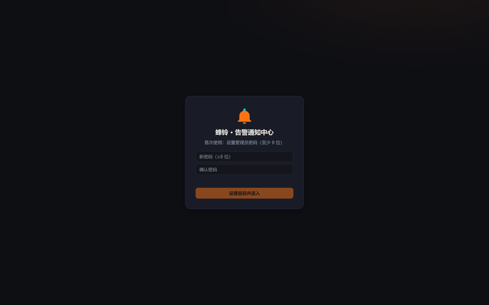

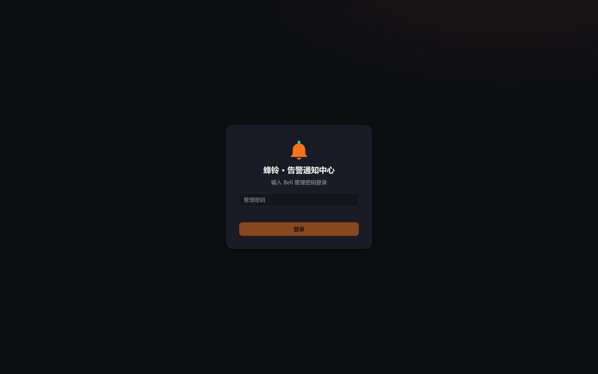

## 通知中心

一切通知的收件箱。顶部四张统计卡（今日通知 / 未读 / 严重告警 / 活跃静默）；其下是**数据流图**（见下节）；再往下是通知流：每条通知带严重级别徽标（INFO / WARN / ERROR / CRIT 四色）、来源（source）、主体（source_ref）与相对时间，`⚡ 实时` 徽标表示 SSE 已连接。

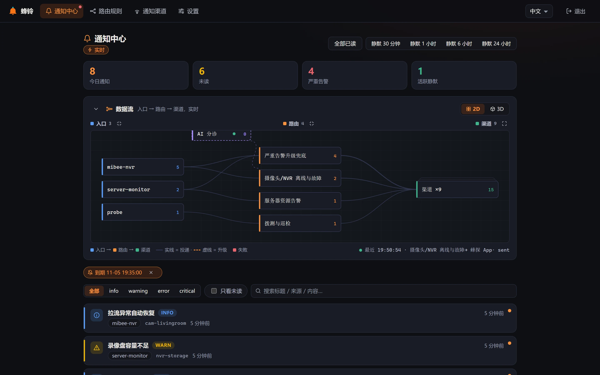

常用操作都在这一页：

- **筛选**：按级别（info/warning/error/critical）、只看未读、按标题/来源/内容搜索。
- **一键静默**：顶部「静默 30 分钟 / 1 小时 / 6 小时 / 24 小时」直接对当前选中通知的 `dedup_key` 建静默——半夜被轰炸时最顺手的一颗按钮。
- **恢复配对**：故障与恢复通知通过 `dedup_key` 自动配对，恢复通知穿透所有闸门立即送达。

**点开任意通知**看完整详情：正文、来源与事件 ID、**逐渠道投递明细**（已送达 ×N / 失败原因），以及三个反馈按钮——「有用」「误报」「以此建规则」（误报一键静默该键；以此建规则自动预填匹配条件跳转规则页）。

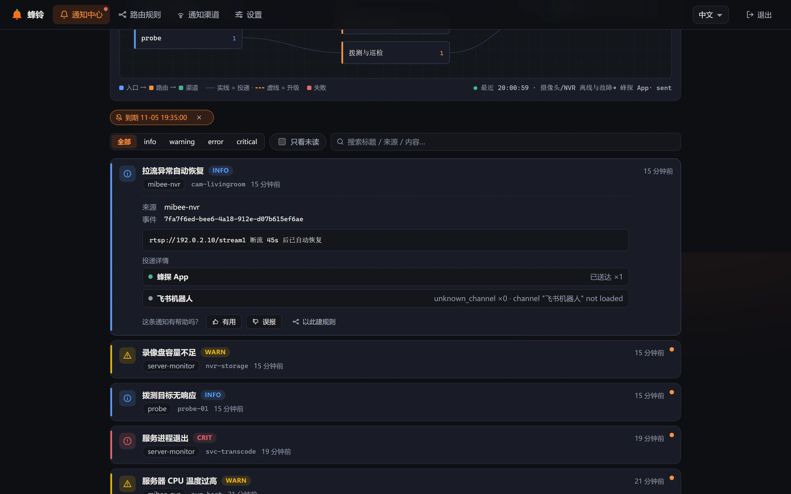

## 数据流图（2D / 3D）

每个页面顶部的「数据流」面板是通知链路的实时可视化：**入口 → 路由 → 渠道**三列，实线=投递、虚线=升级、红=失败，节点旁数字为 24h 流量；右上角 2D/3D 一键切换（3D 可拖动旋转、滚轮缩放）。AI 分诊层启用后同样在图中实时显示健康与用量。

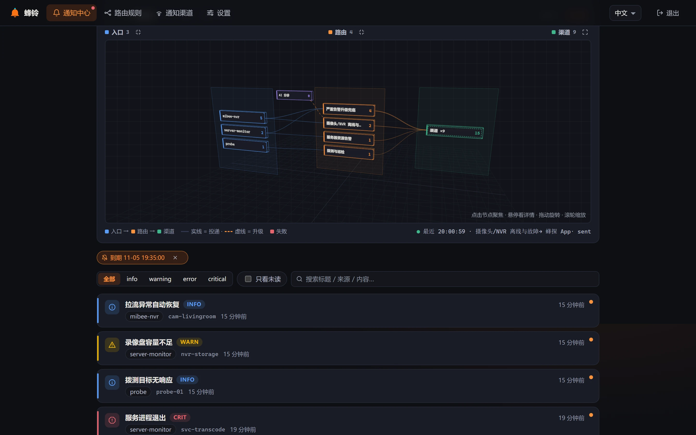

三个页面各有侧重视角：

- **通知中心**：全局流向总览；
- **路由规则**：按优先级自上而下的「编组场」视角——从未命中的规则（虚线轨道）一眼可辨；
- **通知渠道**：「健康塔」视角——塔高=24h 流量、塔身=成功/失败占比、塔顶颜色=健康状态。

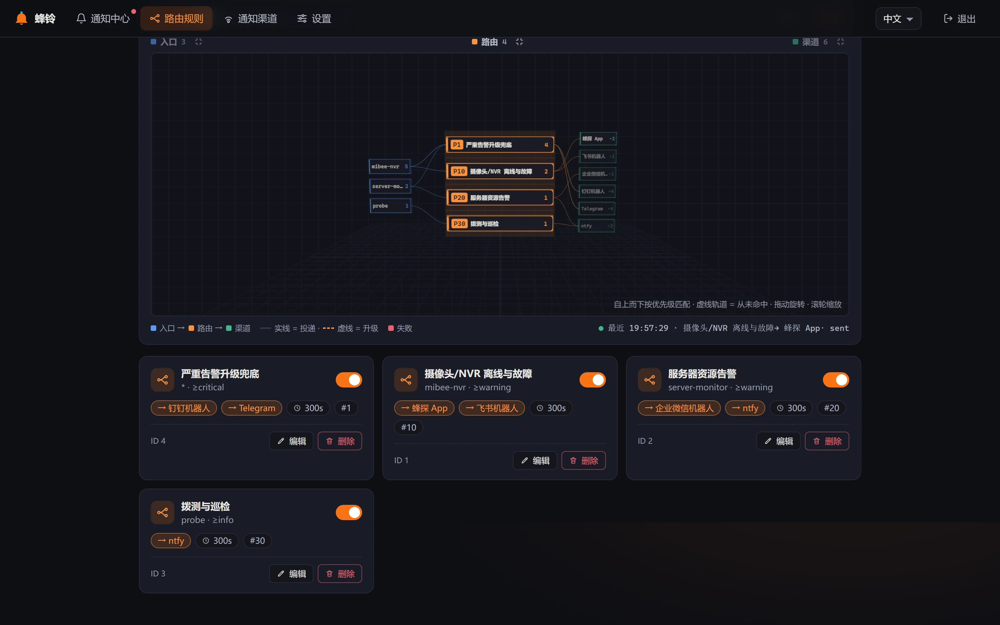

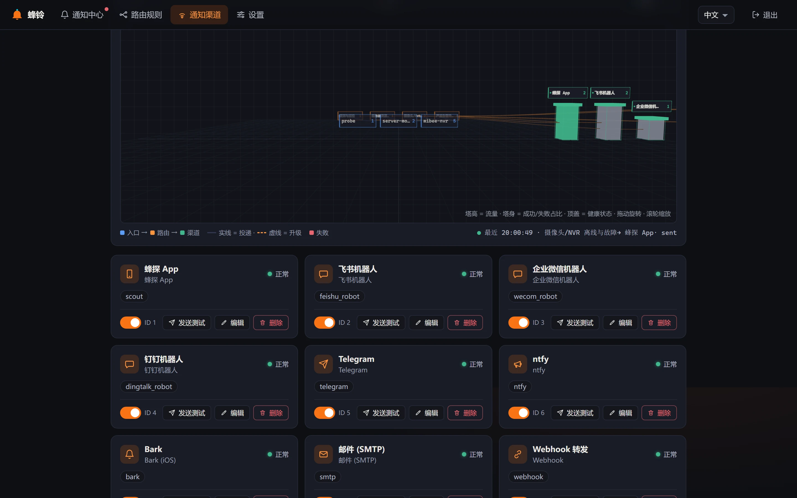

## 路由规则

规则 = 「什么事件（match）→ 走哪些渠道（channels）→ 怎么处理（去抖/冷却/升级）」。每条规则一张卡：匹配条件、目标渠道、去抖窗口、冷却窗口、升级链（escalate_after + escalate_to）、恢复是否通知、L0 持续过滤点数（persist_filter）。

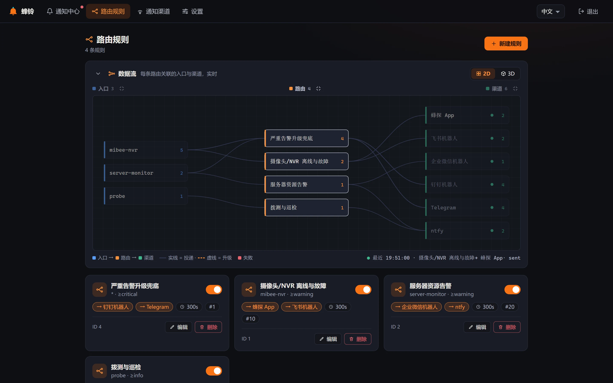

规则存 SQLite，UI 改完即生效，无需重启。优先级（priority）小的先命中；同键冲突取 id 小者。

## 通知渠道

一个渠道 = 一段配置：类型（企微/钉钉/飞书/Telegram/SMTP/Slack/Discord/Bark/ntfy/通用 Webhook 等 17 类）、凭证、渠道级出站代理、启停。健康状态实时可见——连续投递失败自动标记。

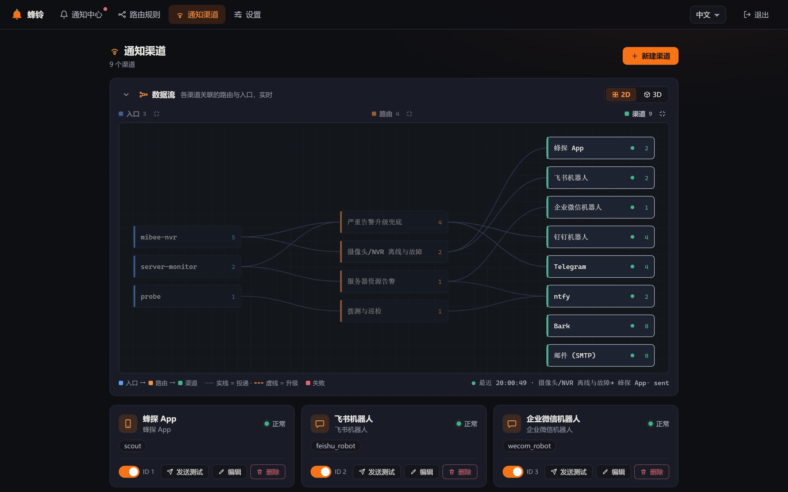

「发送测试」按钮渲染一条真实通知走该渠道，验证凭证与连通性。凭证字段写时加密（AES-256-GCM）、读时脱敏，界面与 API 永远只见 `***`。

## 设置

设置页分四个标签页：

- **总览**：集群（高可用）状态卡 + AI 运行健康卡 + 修改管理密码。2–5 节点全活无主集群的观测入口：成员列表、各节点状态、claim 租约与静默同步情况。单机模式显示单机模式提示；节点死亡时其余节点自动发 `bell.node_down` 告警。
- **AI 与预算**：云端 AI 分析器（L2）、本地决策模型（L1）、每日调用预算、熔断参数；底部为默认关闭的「AI 管道介入（高危）」分区（红色风险提示 + 观察模式），见 [AI 增强](ai.md)。
- **接入与令牌**：五个兼容路由开关（Alertmanager / PagerDuty / 简单 JSON / Grafana / Bark）、**摄取令牌**管理（增删即时生效、按令牌限速）、OpenTelemetry 导出开关。
- **系统与留存**：渲染语言与时区、事件/通知/投递保留期。

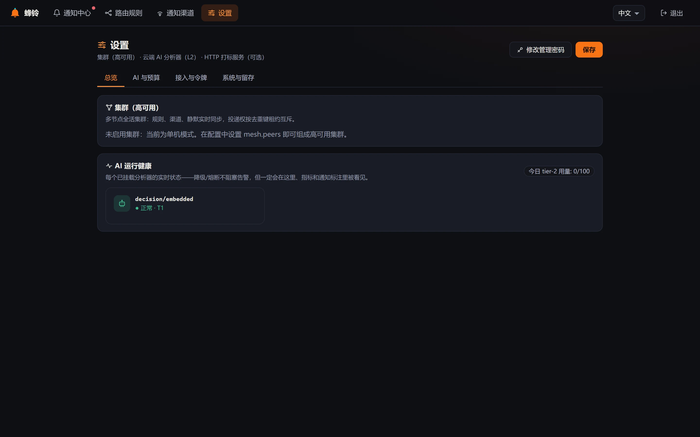

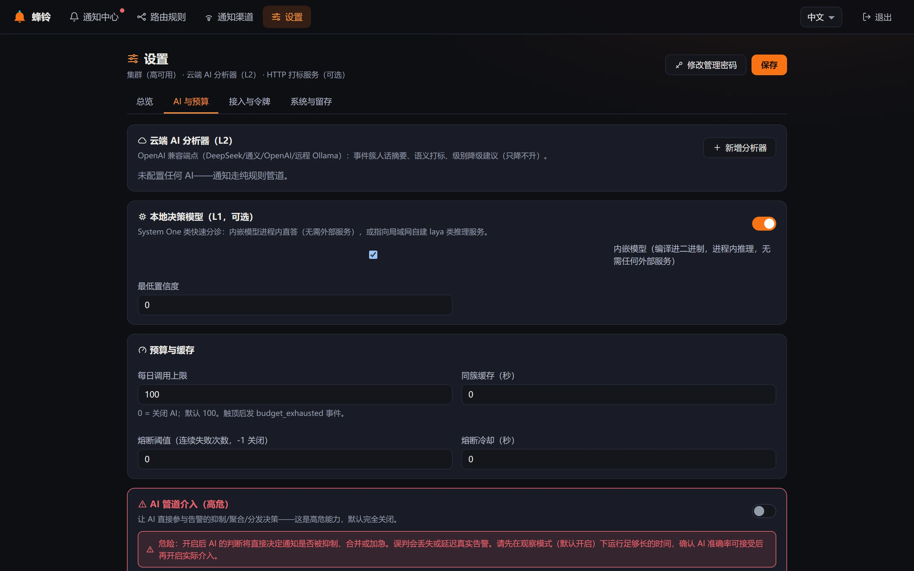

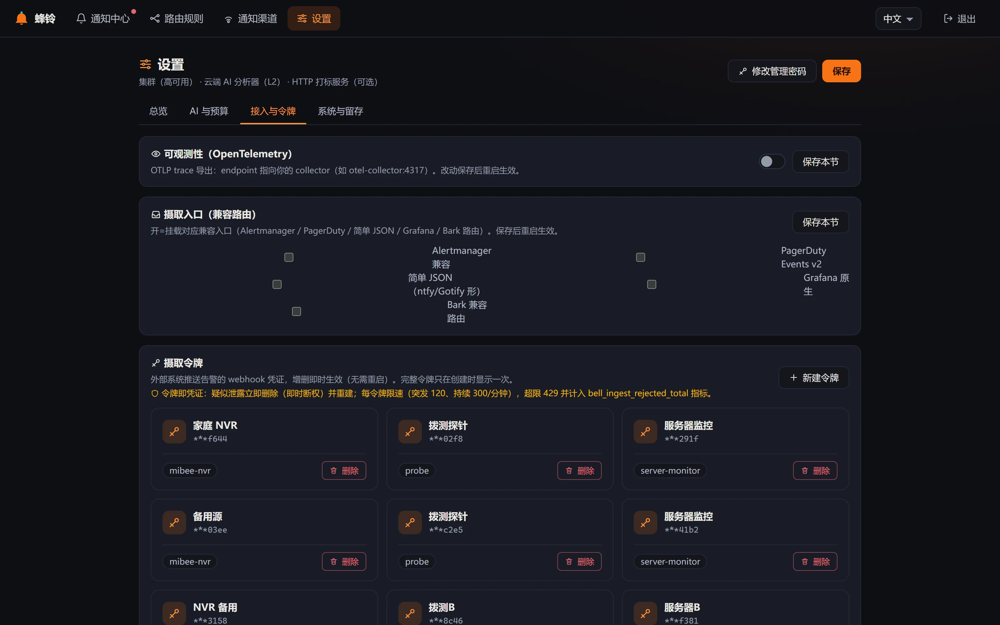

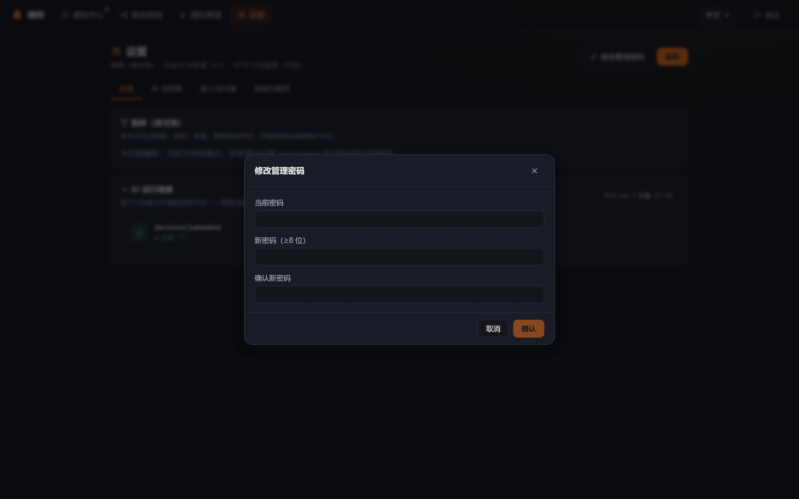

## 移动端

响应式布局，手机浏览器可直接操作（静默/已读最常用）。原生 App 体验由生态 App **MiBeeScout** 提供：它消费 Bell 的通知中心 API（未读列表 + 已读同步 + SSE 实时推送），点击通知可深链跳转 NVR 回放。
