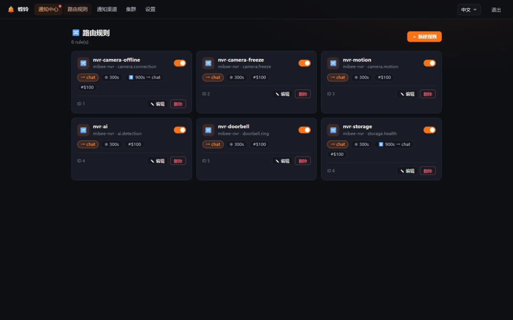
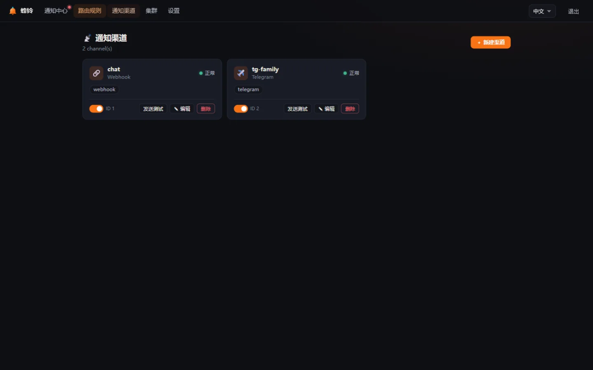
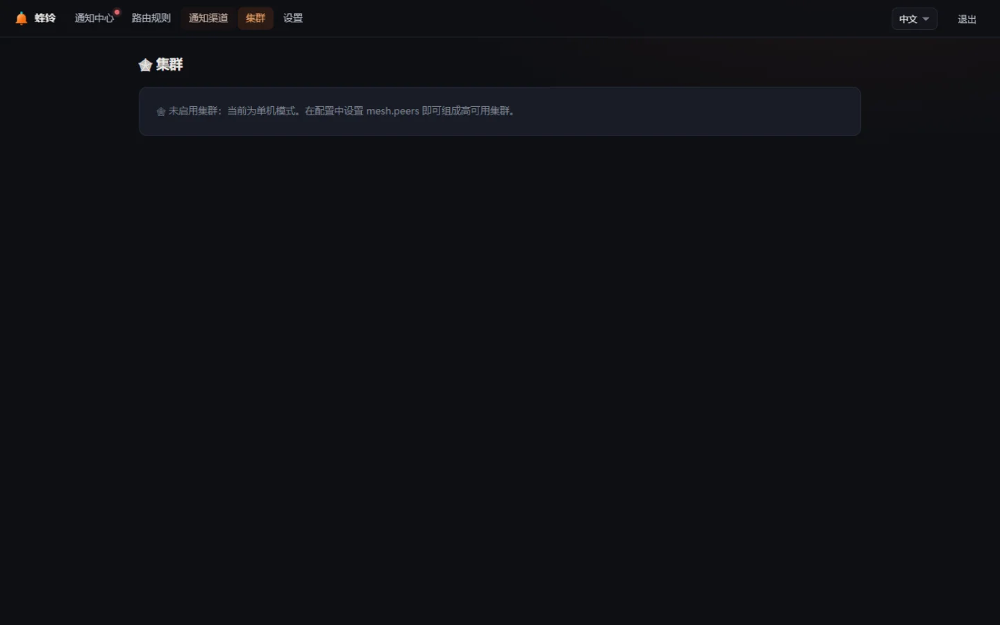
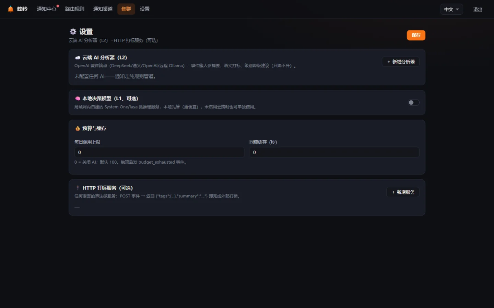

# Web 界面巡礼

MiBeeBell 的管理界面由 Svelte 5 构建、`go:embed` 内嵌进二进制——**没有前端构建步骤、没有额外端口，打开即是**。暗色优先设计，右上角可切换中/英。以下截图来自真实演示实例（数据为演示数据）。

## 通知中心（历史 + 静默管理）

登录后的首页。顶部四张统计卡（今日通知 / 未读 / 严重告警 / 活跃静默）；下方是通知流：每条通知带严重级别徽标（INFO / WARN / ERROR / CRIT 四色）、来源（source）、主体（source_ref）与相对时间，`⚡ 实时` 徽标表示 SSE 已连接。

常用操作都在这一页：

- **筛选**：按级别（info/warning/error/critical）、只看未读、按标题/来源/内容搜索。
- **一键静默**：顶部「静默 30 分钟 / 1 小时 / 6 小时 / 24 小时」直接对当前选中通知的 `dedup_key` 建静默——半夜被轰炸时最顺手的一颗按钮。
- **恢复配对**：故障与恢复通知通过 `dedup_key` 自动配对，恢复通知穿透所有闸门立即送达。

## 路由规则

规则 = 「什么事件（match）→ 走哪些渠道（channels）→ 怎么处理（去抖/冷却/升级）」。每条规则一张卡：匹配条件、目标渠道、去抖窗口、冷却窗口、升级链（escalate_after + escalate_to）、恢复是否通知、L0 持续过滤点数（persist_filter）。

规则存 SQLite，UI 改完即生效，无需重启。优先级（priority）小的先命中；同键冲突取 id 小者。

## 通知渠道

一个渠道 = 一段配置：类型（企微/钉钉/飞书/SMTP/Telegram/Slack/Discord/通用 Webhook…）、凭证、渠道级出站代理、启停。健康状态（ok / degraded / disabled）实时可见——连续投递失败自动转 degraded 并标记。

「发送测试」按钮渲染一条真实通知走该渠道，验证凭证与连通性。凭证字段写时加密（AES-256-GCM）、读时脱敏，界面与 API 永远只见 `***`。

## 集群（Mesh）

2–5 节点全活无主集群的观测页：成员列表、各节点状态、claim 租约与静默同步情况。单机模式这里只有一个节点（自己）。节点死亡时其余节点 30 秒内发 `bell.node_down` 告警——"看门狗互相咬"。

## 设置

两个增强能力的配置入口：

- **AI Providers（L2 摘要）**：OpenAI 兼容端点（DeepSeek / 通义 / OpenAI / 远程 Ollama），配好即用，见 [AI 增强](ai.md)。
- **Enrich 服务（外部打标）**：`http_enrich` 处理器——POST 事件给任意 HTTP 服务，返回 `tags` / `summary` 即完成打标，任何语言写的"算法微服务"都能接入管道。

## 移动端

响应式布局，手机浏览器可直接操作（静默/已读最常用）。原生 App 体验由生态 App **MiBeeScout** 提供：它消费 Bell 的通知中心 API（未读列表 + 已读同步 + SSE 实时推送），点击通知可深链跳转 NVR 回放。
