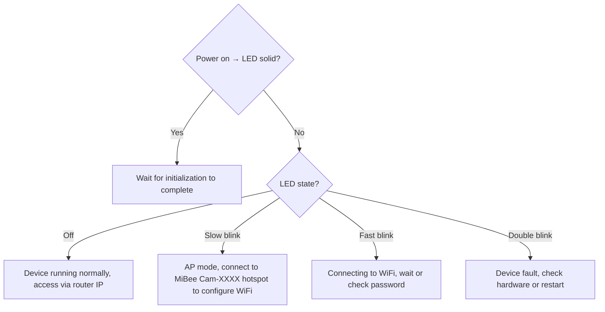

# LED Status Indicator Guide

The onboard LED (GPIO21, active-low) indicates the current operating status through different blinking patterns.

## Status Reference Table

| LED Mode | Visual Display | Status Meaning |
|----------|---------------|----------------|
| Solid | Constant on | System booting |
| Slow blink (1-second cycle) | ON 0.5s → OFF 0.5s, alternating | AP hotspot mode (not connected to router) |
| Fast blink (200ms cycle) | ON 100ms → OFF 100ms, alternating | Connecting to WiFi |
| Off | Constant off | Normal operation (connected to router) |
| Double blink | Two short blinks → long OFF, repeating | Error state (initialization failed / recording anomaly) |

## Detailed Description

### Solid — System Booting

After power-on, LED stays solid indicating the system is executing initialization process (loading configuration, initializing camera, mounting SD card, starting WiFi, etc.). Usually lasts 2-3 seconds.

### Slow Blink — AP Hotspot Mode

Device runs in AP mode, emitting WiFi hotspot (SSID: `MiBee Cam-XXXX`), accessible via `192.168.4.1`.

Scenarios where this state appears:
- First use, WiFi not yet configured
- Auto fallback after 3 WiFi connection failures
- Manually switched to AP mode

**Solution**: Connect to device hotspot, open management page to configure correct WiFi information.

### Fast Blink — Connecting to WiFi

Device is attempting to connect to router. If stuck in this state for a long time, please check:
- Whether WiFi name is correct
- Whether WiFi password is correct
- Whether router is within signal range

After 3 connection failures (60-second interval each), device automatically switches to AP hotspot mode (slow blink).

### Off — Normal Operation

Device has successfully connected to router, camera, recording, and web services are all running normally. At this point, access the management page via the IP address assigned by router.

**How to find IP**:
- Login to router management page to view connected devices
- Use LAN scanning tool (such as Fing)
- View in management page after connecting via AP mode

### Double Blink — Error State

Device has detected a serious error:
- Camera initialization failed
- Recording process anomaly
- Other critical module failure

**Solution**:
1. Try restarting device (hold Boot button 5 seconds for factory reset, or click restart in management page)
2. Check hardware connections (camera cable, SD card insertion)
3. View serial logs for detailed error information

## Quick Diagnosis Flow

