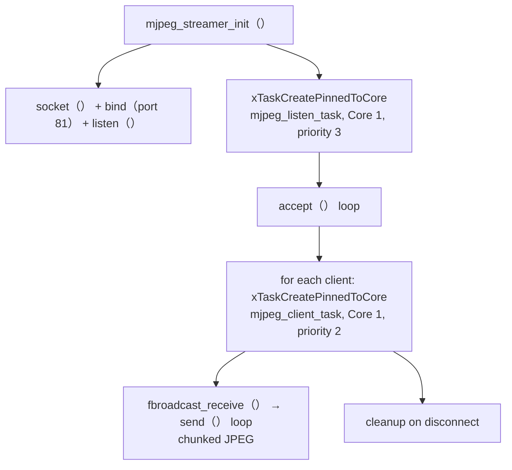
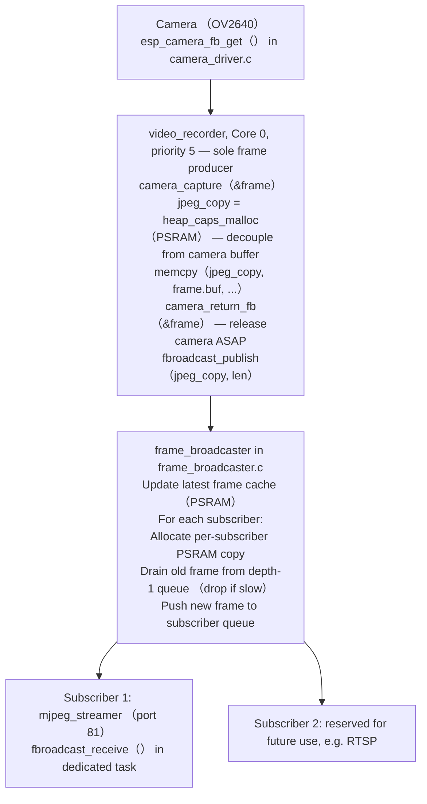

# Port Separation Design: Why MJPEG Streaming Runs on a Separate Port

## Background

MiBee Cam runs two network services on different ports:

| Service | Port | Module | Role |
|---------|------|--------|------|
| REST API + Web UI | 80 | `web_server.c` (ESP-IDF httpd) | Config, file management, OTA, status |
| MJPEG Live Stream | 81 | `mjpeg_streamer.c` (raw TCP) | Real-time camera preview |

This separation is not arbitrary — it is a deliberate architectural decision to ensure system stability.

## Root Cause: ESP-IDF httpd Is Single-Threaded

The ESP-IDF `httpd` component (`esp_http_server`) runs on a **single-threaded event loop**. It uses one internal task that calls `select()` on all registered sockets, then dispatches incoming requests to handler functions one at a time.

This means:

1. **A long-lived handler blocks everything else.** MJPEG streaming (`multipart/x-mixed-replace`) is inherently a long-lived connection — the handler must continuously send JPEG frames and **never returns** until the client disconnects. If this ran inside httpd, it would monopolize the event loop.

2. **Socket pool exhaustion.** httpd on port 80 is configured with `max_open_sockets = 4`. Two MJPEG clients would consume half the available connections, leaving only 2 for all REST API + Web UI traffic.

3. **No priority control.** httpd runs at whatever priority the IDF assigns (typically low). MJPEG streaming, REST API calls, WebSocket pushes, and file downloads all compete on equal footing inside the same event loop. No way to prioritize critical API responses over frame transmission.

4. **Cascading failures under network stress.** WiFi on ESP32-S3 is shared between TX and RX. When the MJPEG stream is pumping frames, any TCP retransmission or WiFi DELBA event (common in noisy 2.4GHz environments) causes backpressure that stalls the httpd event loop — making the entire Web UI and API unresponsive.

## Architecture: How Port 81 Solves This

### Independent TCP Server

`mjpeg_streamer.c` creates its own TCP server socket on port 81, completely bypassing httpd:

### Key Design Properties

| Property | Port 80 (httpd) | Port 81 (mjpeg_streamer) |
|----------|-----------------|--------------------------|
| Threading model | Single event loop | One FreeRTOS task per client |
| Max connections | 4 sockets | 2 clients (`MAX_STREAM_CLIENTS`) |
| Task priority | httpd default (low) | Listen=3, Client=2 |
| CPU core | Default | Pinned to Core 1 |
| Stack size | 16384 bytes | 4096 bytes per client task |
| Blocking | Handler must return quickly | Client task blocks on `fbroadcast_receive()` |
| Impact of slow client | Blocks entire httpd | Only affects that client's task |

### Frame Distribution Pipeline

Both port 80 and port 81 consume camera frames through `frame_broadcaster.c`, but via different mechanisms:

**Key detail**: The broadcaster gives each subscriber its own PSRAM copy. This means MJPEG client tasks never hold references to camera driver buffers — the camera can capture the next frame immediately without waiting for network I/O.

## What Would Happen Without Port Separation

If MJPEG streaming was handled by a httpd URI handler on port 80:

1. **API becomes unresponsive under load.** While streaming frames to a browser, the httpd event loop is stuck inside the stream handler. Config changes, file downloads, OTA uploads — all queued and waiting.

2. **WebSocket stops pushing.** The WebSocket server (`ws_server.c`) is registered on the same httpd instance. Real-time status updates and motion events would be delayed or dropped.

3. **No graceful degradation.** A single slow MJPEG client (e.g., poor WiFi signal causing TCP retransmissions) would degrade ALL services, not just that client's stream.

4. **Watchdog risk.** If httpd blocks long enough on a stalled MJPEG send, the 30-second TWDT could trigger a panic reboot — taking down the entire device because one client has bad connectivity.

## Resource Budget

| Resource | Port 80 (httpd) | Port 81 (mjpeg_streamer) | Total |
|----------|-----------------|--------------------------|-------|
| TCP sockets | 4 max | 2 + 1 listen | 7 |
| FreeRTOS tasks | 1 (httpd internal) | 1 listen + 2 client max | 4 |
| Stack (DRAM) | 16384 bytes | 4096 × 3 = 12288 bytes | ~28 KB |
| PSRAM per frame | N/A | ~15-30 KB × 2 subscribers | ~60 KB |

## Configuration Reference

- **Stream port**: Hardcoded as `STREAM_PORT 81` in `mjpeg_streamer.c`
- **Max stream clients**: `MAX_STREAM_CLIENTS 2` in `mjpeg_streamer.c`
- **Send timeout**: `SEND_TIMEOUT_MS 5000` — stuck clients auto-disconnected
- **Frame drop**: Broadcaster uses depth-1 queues — slow clients drop frames automatically
- **httpd sockets**: `config.max_open_sockets = 4` in `web_server.c`

## See Also

- [System Architecture](seeed-architecture.md) — Full system overview
- [API Reference](seeed-api-overview.md) — REST API endpoints on port 80
- `main/mjpeg_streamer.c` — Implementation (381 lines)
- `main/frame_broadcaster.c` — Frame distribution hub (252 lines)
