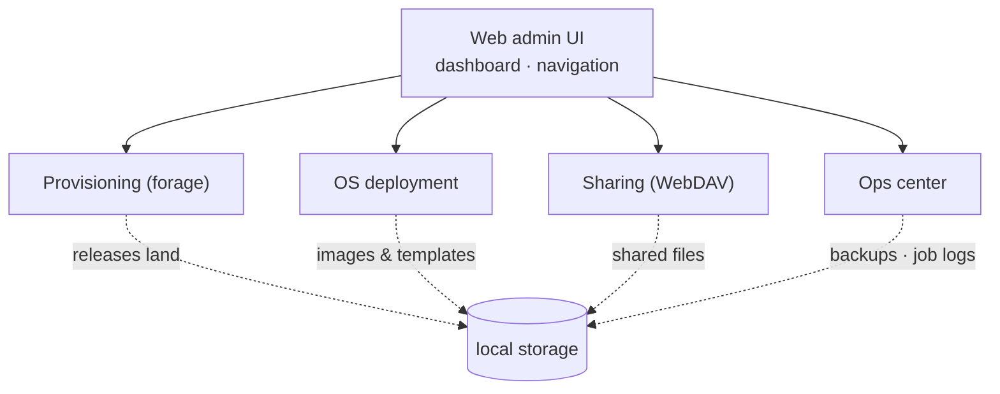

# Feature Overview

Everything in MiBeeHive is used through the embedded web UI: a sidebar groups modules and a dashboard aggregates global state. This chapter walks the modules.

## Provisioning (foraging)

"Restock the LAN": pull public releases onto local disk once so every LAN device can fetch them nearby.

- **Projects & sources**: create a project per release type, with source and version rules
- **Supported channels**: GitHub Releases, Go binaries/modules, NPM, PyPI, HashiCorp products, Grafana distributions
- **Download queue**: background scheduling with retries — failures are re-fetched automatically
- **API tokens**: access tokens for automation scripts, revocable anytime
- **Full-text search**: file- and project-level search to locate things fast

## OS deployment

"Batch installs": plug in a new machine's network cable, boot from network, and the OS installs itself.

- **PXE network-boot endpoint**: works with DHCP/TFTP — pick the boot entry and the installer takes over
- **Unattended answer templates**: Debian/Ubuntu (preseed), RHEL-family (kickstart), Ubuntu Server (autoinstall) template management, generated per machine
- **ISO catalog & downloads**: catalog-managed OS images with background downloads
- **Config preview**: inspect the generated answer file before handing it to a machine

## Sharing (WebDAV)

- Standard WebDAV — mounts natively on Windows / macOS / Linux
- Configurable access: anonymous read-only + admin read-write
- HTTPS supported (self-signed certificates fine) for encrypted LAN transfer

## Ops center

### Container management

- Container list and lifecycle: start / stop / restart, live logs, resource stats
- Image management and app templates for one-click containers

### Scheduled jobs

- Run scripts on a cron schedule; output and exit codes are kept as logs
- Made for the LAN chores: periodic cleanup, periodic backup, periodic inspection

### Key management

- Create and manage keys (API tokens, channel credentials) in the web UI
- **Write-only**: plaintext is never shown again after creation; rotate anytime

### Backup & restore

- One-click full backup (database + config + scripts), restorable from the UI
- Archives stay on local disk and can be downloaded

### System status & monitoring

- Dashboard: live CPU / memory / disk / network charts, configurable disk-threshold alerts
- Prometheus integration via `/metrics`; node_exporter data can be scraped for full-machine view
- A global activity timeline covers foraging, deployment and backup events

## Platforms & resources

| Item | Requirement |
|---|---|
| Architecture | ARM64 (preferred — NAS / Raspberry Pi class) · x86_64 works too |
| Memory | ≥1GB |
| Storage | plan for your release/image volume; ≥32GB to start |
| Deployment | single binary + systemd; SQLite single-file storage |

## Next steps

- [FAQ](faq.md) — first login, backup & restore, upgrades, monitoring
