# Product Introduction

**MiBeeHive** is the self-hosted ops supply hub of the MiBee ecosystem: it folds **provisioning, restocking, sharing and inspecting** — four everyday homelab chores — into one web UI. Deploy it on your ARM64 NAS or any small box, and your LAN gets a single supply-and-ops entry point. Files, scripts and images all stay on your own hardware.

In one sentence: public release sources (GitHub Releases, Go modules, NPM, PyPI, …) are "foraged" onto local disk by the hive; bare-metal machines are "provisioned" over PXE; files are "shared" via WebDAV; devices and jobs are "inspected" by the ops center.

## What it solves

| Homelab pain point | MiBeeHive's answer |
|---|---|
| Slow WAN bandwidth — every device pulls the same release | Forage once, reuse everywhere — releases land on local disk |
| Installing a new machine means hunting ISOs and typing answers | OS deployment: PXE network boot + unattended answer templates — plug in the cable and install |
| Team files scattered everywhere with messy permissions | WebDAV sharing: one entry point, configurable read-only / read-write |
| Scripts, keys and backups scattered across machines | Ops center: scheduled jobs, key management, backup & restore in one place |
| Nobody watches device state until the disk fills | System dashboard + disk-threshold alerts + Prometheus metrics |

## Capability map

| Module | What it does |
|---|---|
| Provisioning (foraging) | Fetch releases from GitHub / Go / NPM / PyPI / HashiCorp / Grafana to local disk: projects, download queue, API tokens, full-text search |
| OS deployment | Unattended installs: PXE network-boot endpoint, preseed/kickstart/autoinstall templates, ISO catalog & downloads |
| Sharing | WebDAV file service: anonymous read-only + admin read-write, HTTPS with self-signed certs supported |
| Ops center | Container management (start/stop/logs/stats/images/app templates), scheduled jobs (cron scripts + logs), key management, backup & restore, system status |

## Design principles

1. **Single binary, zero dependencies**: one executable with the full web UI embedded, SQLite storage — no external database, no message queue. Drop it on a NAS and run.
2. **Designed for low-spec hardware**: an ARM64 NAS at the 1GB-RAM class runs it comfortably; "runs on a Raspberry Pi" is the acceptance line.
3. **All data local**: foraged releases, install images, shared files and backup archives live on your own disks — no third party in the path.
4. **LAN-oriented**: it is a LAN supply hub, not a public service; pair it with your own VPN/tunnel if you need remote access.

## Status

MiBeeHive is **not publicly released yet** — the distribution channel for runnable artifacts is to be announced. This manual tracks development and serves as an early look.

## Next steps

- [Feature overview](features.md) — what each module does and how to use it daily
- [FAQ](faq.md) — first login, backups, upgrades, monitoring
