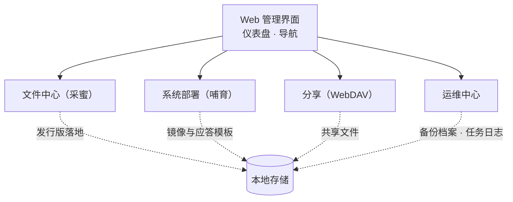

# 功能总览

[English](../en-US/features.md)

MiBeeHive 的全部能力通过内嵌 Web 界面使用：左侧导航按模块分区，仪表盘聚合全局状态。本章按模块说明能做什么、日常怎么用。

## 文件中心（采蜜）

面向"内网补料"：把公共渠道的发行版统一抓到本地，供内网设备就近取用。

- **项目与源管理**：为每类发行版建项目，配源与版本规则
- **支持渠道**：GitHub Releases、Go 二进制/模块、NPM、PyPI、HashiCorp 产品、Grafana 发行版
- **下载队列**：后台队列调度与重试，失败自动补抓
- **API 令牌**：给自动化脚本用的访问令牌，随时可吊销
- **全文搜索**：文件名与项目级搜索，快速定位

## 系统部署（哺育）

面向"批量装机"：新机器网线一插，从网络启动自动完成装系统。

- **PXE 网络启动端点**：DHCP/TFTP 引导配合，机器选启动项即可进入安装
- **无人值守应答模板**：Debian/Ubuntu（preseed）、RHEL 系（kickstart）、Ubuntu Server（autoinstall）模板管理，按机器生成
- **ISO 目录与下载**：常用系统镜像目录化管理，后台队列下载
- **配置预览**：下发前预览生成的应答文件，避免装机翻车

## 分享（WebDAV）

- 标准 WebDAV 协议，Windows / macOS / Linux 原生客户端可直接挂载
- 访问模式可配：匿名只读 + 管理员读写
- HTTPS 支持（含自签证书），内网传输加密

## 运维中心

### 容器管理

- 容器列表与生命周期：启动 / 停止 / 重启，实时日志，资源统计
- 镜像管理与常用应用模板（一键起容器）

### 计划任务

- 定时执行脚本（cron 表达式），输出与退出码留存日志
- 适合"定期清磁盘 / 定期备份 / 定期巡检"这类内网杂务

### 密钥管理

- 在 Web 界面创建与管理密钥（API token、渠道凭证等）
- **只写不回显**：密钥创建后界面不再显示明文，可随时轮换

### 备份与恢复

- 一键全量备份（数据库 + 配置 + 脚本），Web 界面可随时恢复
- 备份档案本地留存，可下载带走

### 系统状态与监控

- 仪表盘：CPU / 内存 / 磁盘 / 网络实时图表，磁盘阈值告警可配
- 对接 Prometheus：`/metrics` 指标端点，可抓取 node_exporter 数据
- 全局活动时间线：采蜜、部署、备份等事件一目了然

## 平台与资源

| 项 | 要求 |
|---|---|
| 架构 | ARM64（首选，NAS/树莓派级别即可）· x86_64 可跑 |
| 内存 | ≥1GB |
| 存储 | 按采蜜/镜像体量规划，≥32GB 起步 |
| 部署形态 | 单二进制 + systemd；SQLite 单文件存储 |

## 下一步

- [常见问题](faq.md)——首次登录、备份恢复、升级与监控对接
