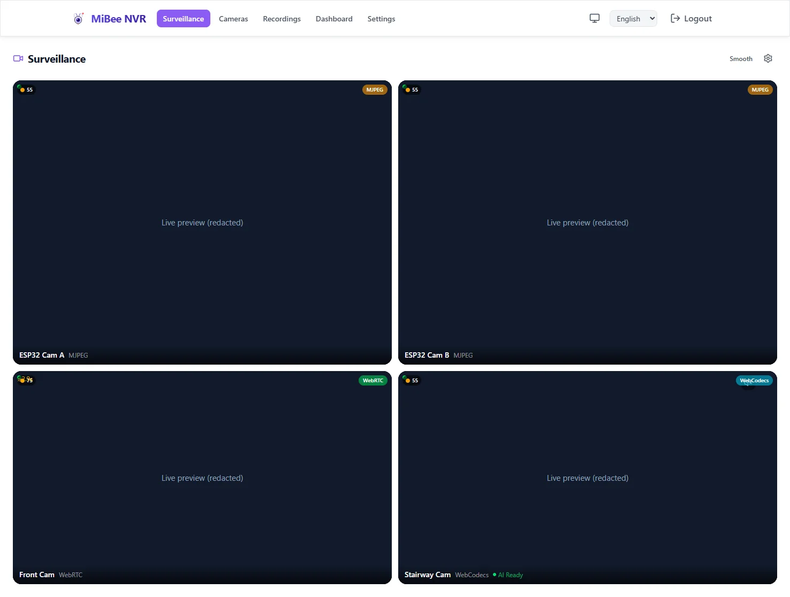

# Web UI Tour

> For MiBeeNvr v0.15.0

The MiBee NVR web interface is organized into five top-level pages plus the single-camera live page. This page is a feature cheat sheet; step-by-step configuration lives in the dedicated guides.

## Surveillance (Home)

The default page after login — a live multi-camera grid:

- **Grid layout**: the "Configure" button opens the **camera picker** to choose which cameras to show (4 by default, with 6/9/12/16 tiers subject to the server's HLS preview budget)
- **Header quality switch**: a **Smooth / HD** toggle for the whole grid — "Smooth" rides the camera's [sub-stream](sub-stream.md) (default), slashing bandwidth and decode load when viewing many cameras at once; cameras without one silently fall back to the main stream
- **Per tile**: camera name, live badge, playback protocol (WebCodecs / MJPEG, etc.), and a **health score**
- **Tile controls**: unmute (cameras with audio) and fullscreen
- **AI overlay**: with [browser-side AI detection](https://github.com/Mi-Bee-Studio/MiBeeNvr/blob/v0.15.0/docs/en/ai-detection-tuning.md) enabled, detection boxes draw directly on the feed
- **Click a tile** to open that camera's live page

The picker is built for larger fleets: a **search box** filters by name / group; the **Online only** toggle hides offline cameras by default (already-selected offline ones stay visible so you can deselect them); cameras are organized into per-group sections with counts, and **Add group** fills the remaining grid slots with that group's cameras in order. Selected chips are numbered in pick order and removable with ×.

Above four tiles, enable **Photo wall**: anchor the enlarged tile top-left, top-right, bottom-left, bottom-right, or center, or choose two or three featured tiles. Small tiles dense-pack the remainder and featured tiles can rotate. In HD mode above four tiles, only featured tiles use the main stream; the rest stay on sub-streams. Refreshes suspend while the grid is hidden and resume on return; `/flow` polling drops to half frequency, and route keep-alive suspension further reduces idle load.

> H.265 cameras play in the browser via WASM decoding — no HTTPS or plugins needed; see [Streaming Protocol Selection](https://github.com/Mi-Bee-Studio/MiBeeNvr/blob/v0.15.0/docs/en/streaming-protocol-selection.md).

## Cameras

Full camera lifecycle management:

| Action | Description |
|---------|-------------|
| Scan Devices | ONVIF / Xiaomi auto-discovery, see [ONVIF Auto-Discovery](onvif-discovery.md) |
| + Add Camera | manually add a camera of any protocol |
| Start/Stop switch | temporarily disable / re-enable a camera (config and recordings kept) |
| Restart | disconnect and reconnect the camera |
| Live | open the live page |
| Activate | some GB / ONVIF devices need activation first |
| Archived | archived old cameras (replaced devices, record keeping) |
| New Group | create groups to organize cameras — drag cards between groups; rename / delete / reorder from the group header |

Cards show the run state (recording / live-only / stopped / reconnecting / unreachable) plus protocol and codec tags.

### Camera Groups

When the fleet grows, keep it organized:

- **New Group** in the toolbar creates an empty group
- Group headers **collapse / expand** on click (state persists across reloads), the pencil icon **renames inline** (member cameras follow), and the trash icon **deletes** the group (members fall back to "Ungrouped")
- **Drag camera cards** between groups (empty groups show a dashed drop zone) and **drag group headers** to reorder; "Ungrouped" always sits last
- The edit form's **Group** field (basic-info section) accepts a new name or picks from existing groups; leave it empty for ungrouped

The edit form is organized into collapsible sections; beyond basic access settings these include:

- **[Recording mode](adaptive-recording.md)**: continuous or adaptive (motion-aware) — the latter carries audio-trigger and ambient-audio options
- **[Sub-stream](sub-stream.md)**: ONVIF sub-stream auto-discovery or a manual sub-stream RTSP URL
- **Storage**: assign this camera its own recording root and enqueue [background migration](storage-management.md) for its history
- **GB cascade**: whether to expose this camera to the upper platform, and whether to cascade its sub-stream

## Recordings

The search-and-playback center with three views:

- **Timeline** (default): one track per camera for the day, AI events overlaid as markers and timelapse samples / merged timelapse segments drawn as bars (click a timelapse bar to play); click / drag to position playback
- **List**: segment details (format, duration, size, merge status) with multi-select delete
- **Timelapse**: dedicated timelapse view

The toolbar filters by type (video / timelapse / MJPEG), camera, **AI detection** (person / vehicle), **activity** (motion / static / scene-cut, plus a minimum activity score), and keyword search. See [Recording & Playback](recording-playback.md).

## Dashboard

Operations at a glance, organized into four tabs:

- **Storage trend** (default): a stacked daily-write chart per camera (custom SVG) — **the legend doubles as a camera selector** (click to isolate / toggle / click again to restore), each bar independently sorted by that day's write volume, hover a segment for the day's breakdown, one click flips the sort direction; the "Camera Status" card below shows **segment count and storage usage per row** (sortable headers), plus a per-camera storage card (usage, segments, share bar)
- **Health history**: camera health-event timeline
- **Transcoding history**: transcode job log
- **AI Events**: detection events pushed by the server-side AI backend (MiBeeVision integration) — filter by camera and event type (zone entry / line crossing / loitering / object detected); each event can **jump to the matching recording moment**. Visible only when an external AI backend is configured

> Each row of the camera-status card expands into a **link-diagnosis tree** (capture source → hub → recording / live consumers / health / relay / sub-stream) — green = active, gray = idle, orange = anomalous, red = heavy frame loss. See [Observability](observability.md).

## Settings

Nine pages: **General** (timezone / port / frontend prefs), **Storage** (root path, [candidate volumes & migration](storage-management.md)), **Camera Access**, **Streaming**, **GB28181**, **AI Detection** (browser-side detection + MiBeeVision integration + per-camera config), **Recording & Processing** (incl. [activity-aware cleanup](https://github.com/Mi-Bee-Studio/MiBeeNvr/blob/v0.15.0/docs/en/adaptive-recording.md#activity-scores--retrieval)), **Advanced**, **About**.

- The "A new version is available" badge on the nav signals an upgrade (see the [Upgrade Guide](https://github.com/Mi-Bee-Studio/MiBeeNvr/blob/v0.15.0/docs/en/upgrade-guide.md))
- Most settings apply immediately; a few (like the storage path) need a restart

## Live Page (Single Camera)

Opened from the grid or a camera card at `#/live/{id}`:

- Large live view with protocol switching
- **Quality switcher**: switch between main / [sub-stream](sub-stream.md) when the camera has one
- **PTZ control**: pan/tilt/preset control for capable cameras (ONVIF / Xiaomi PTZ models / GB28181 channels); hold a direction to move, release to stop, with a three-step speed selector (slow / medium / fast)
- **Two-way audio**: push-to-talk back to the camera (see [Audio](audio.md))
- **Snapshot**: save the current frame
- **Camera settings**: a collapsible panel at the bottom embeds this camera's edit form — adjust access parameters without navigating away; saving silently refreshes probes without interrupting playback

## Interface Preferences

- **Theme**: light / dark / follow system (toggle top-right)
- **Language**: 中文 / English (toggle top-right, applies instantly)
- **PWA**: installable as a standalone app on desktop / phone home screens; the UI opens offline

## Next Steps

- [Getting Started](https://github.com/Mi-Bee-Studio/MiBeeNvr/blob/v0.15.0/docs/en/getting-started.md) — add your first camera
- [CLI Reference](cli.md) — command-line administration
- [Live Relay](https://github.com/Mi-Bee-Studio/MiBeeNvr/blob/v0.15.0/docs/en/relay-guide.md) — push feeds to streaming platforms
