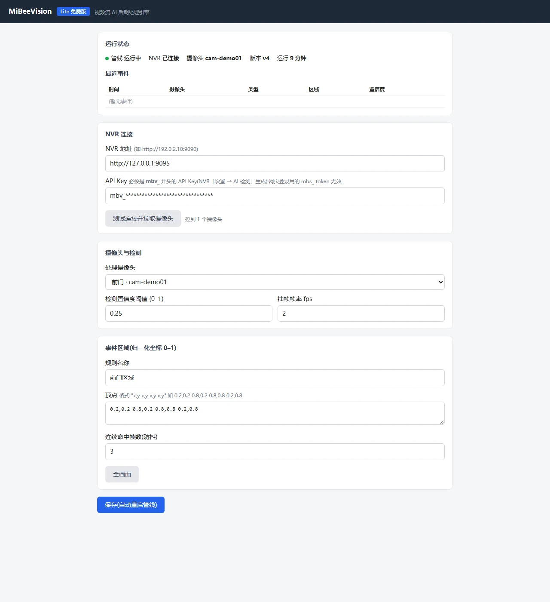

# MiBee Vision 智能分析

MiBee Vision 是与 MiBee NVR 配套的服务端智能分析组件：对 NVR
已录制的视频做 AI 目标检测，按规则区域生成事件并写回 NVR，
在网页端直接浏览与检索。

## 版本与获取

当前公开发布的版本为 **MiBeeVision Lite（免费版）**，随 MiBee NVR 的
[GitHub 发布页](https://github.com/Mi-Bee-Studio/MiBeeNvr/releases)分发，
在发布列表中找到名称以 `mibee-vision-` 开头的发行版即可下载。

- **平台**：Linux（x86_64 / ARM64），低功耗主机（如树莓派）即可运行。
- **Lite 版能力**：单摄像头、CPU 推理，检测模型已内置，无需额外下载。
- **版本线**：Vision 使用独立版本号（如 `mibee-vision-v0.1.0`），与
  MiBeeNVR 的版本相互独立；许可说明见发布页（内置检测模型 YOLOv8n
  采用 Ultralytics AGPL-3.0 许可）。

Vision 与 NVR 在同一台机器或分机部署均可；分析在独立的设备或服务器上
完成，不占用 NVR 本机的分析算力，录像性能不受影响。

## 它能做什么

- **事后智能分析**——对 NVR 录好的视频片段进行目标检测，检测过程
  与录像完全解耦。
- **区域事件**——在画面上划定规则区域，有人进入区域即产生带置信度的
  事件（如「区域入侵 · 人」），写回 NVR 的 **AI 事件页**：按日分组、
  可按摄像头与事件类型筛选、一键跳转到对应录像位置。
- **网页配置页**——NVR 连接、摄像头选择、规则区域、运行状态与最近
  事件集中在一个网页里，接入无需手工编辑配置之外的任何操作。



## 接入教程

全程约十分钟，需要 **v0.12.0 及以上**版本的 MiBee NVR。

### 1. 在 NVR 生成 API Key

进入 **设置 → AI 检测 → MiBeeVision 集成**，点击生成 API Key。
密钥形如 `mbv_…`，**只在生成时显示一次**，请妥善保存；同一页面
可以随时吊销。

> 注意：必须使用这里生成的 API Key。网页登录会话用的 `mbs_` token
> 对 Vision 无效，用它回写 AI 事件会被拒绝。

### 2. 下载并解包

在发布页的 MiBeeVision Lite 发行版中，下载与主机架构匹配的二进制和
ONNX Runtime 库（连同 `SHA256SUMS` 与 `README.txt`），放到同一目录
（如 `/opt/mibee-vision/`），并为二进制加执行权限：

```bash
cd /opt/mibee-vision
chmod +x mibee-vision-lite-v0.1.0-linux-aarch64
```

### 3. 初始化配置

```bash
./mibee-vision-lite-v0.1.0-linux-aarch64 config init
```

会在当前目录生成 `config/config.toml`。按部署方式二选一修改：

- **分机部署（推荐，Vision 与 NVR 不同机）**：把 `[transport]` 节的
  `type` 改为 `http_download`（Vision 通过 NVR 的 HTTP 接口下载录像
  再分析）；同时把 `[source]` 节的 `camera_whitelist` 临时改为
  `["pending"]`——Lite 版要求启动前已选择摄像头，这里先放一个占位值，
  稍后在配置页选择真实摄像头即可覆盖。
- **同机部署**：保持 `local_file` 不变，把 `[source.nvr_files]` 的
  `dir` 指向 NVR 的录像存储目录（`camera_whitelist` 同样先放占位值）。

### 4. 启动

```bash
ORT_DYLIB_PATH=/opt/mibee-vision/libonnxruntime-1.17.1-linux-aarch64.so \
  /opt/mibee-vision/mibee-vision-lite-v0.1.0-linux-aarch64 serve
```

`ORT_DYLIB_PATH` 必须指向随包的 `libonnxruntime-*.so`——缺失时推理库
无法加载，配置页能打开但永远处理不了录像段。这是最常见的启动问题。

希望开机自启时，可用 systemd 托管（示例）：

```ini
[Unit]
Description=MiBeeVision Lite
After=network-online.target

[Service]
WorkingDirectory=/opt/mibee-vision
Environment=ORT_DYLIB_PATH=/opt/mibee-vision/libonnxruntime-1.17.1-linux-aarch64.so
ExecStart=/opt/mibee-vision/mibee-vision-lite-v0.1.0-linux-aarch64 serve
Restart=on-failure

[Install]
WantedBy=multi-user.target
```

### 5. 网页配置

浏览器打开 `http://<Vision 主机 IP>:9092`：

1. 填入 NVR 地址（如 `http://192.0.2.10:9090`）与第 1 步生成的
   API Key，点「**测试连接并拉取摄像头**」，成功会列出摄像头；
2. 在「处理摄像头」中选择要分析的摄像头（Lite 一次处理一路）；
3. 检测置信度阈值与抽帧帧率保持默认即可；
4. 在「事件区域」中填规则名称与区域顶点（0–1 归一化坐标，也可点
   「全画面」一键填充），连续命中帧数用于防抖；
5. 点「**保存(自动重启管线)**」——顶部状态区显示
   「管线 运行中 / NVR 已连接」即接入成功。


### 6. 验证

- 配置页状态区：**管线 运行中**、**NVR 已连接**；
- NVR 网页端打开 **仪表盘 → AI 事件**：有人进入规则区域后会出现事件，
  录像列表的 AI 标记转为「已完成」。


## 常见问题

| 症状 | 原因与处理 |
|---|---|
| 配置页能打开，但管线启动失败或永远没有结果 | 未设置 `ORT_DYLIB_PATH`（或路径没指向随包的 `.so`），见上文第 4 步 |
| 保存后录像的 AI 标记一直为空 | 用了网页登录 token（`mbs_`）而不是 API Key（`mbv_`），回写被 NVR 拒绝；请在 NVR 重新生成 API Key 并在配置页更新 |
| 日志报「打开视频失败… No such file or directory」 | Vision 与 NVR 不同机但传输模式仍是 `local_file`；按第 3 步改为 `http_download` |
| 网页保存报 JSON 解析错误（missing field …） | 配置文件被手工精简、缺少必要字段；删掉 `config/config.toml` 后重新 `config init`，再只修改第 3 步提到的项 |

## 与浏览器端 AI 检测的关系

NVR 网页端另有一套运行在浏览器里的实时检测框叠加（参数调整见
[AI 检测调参指南](ai-detection.md)）。它与 Vision 相互独立：
浏览器检测只影响你观看时的画面叠加，Vision 则负责服务端的录像
事后分析并把事件写回 NVR——两者可以同时使用。

## MiBee App

配套的手机端 **MiBee App**（内测中）可在局域网内直连 NVR，观看
直播与回放录像，这里不再展开。
